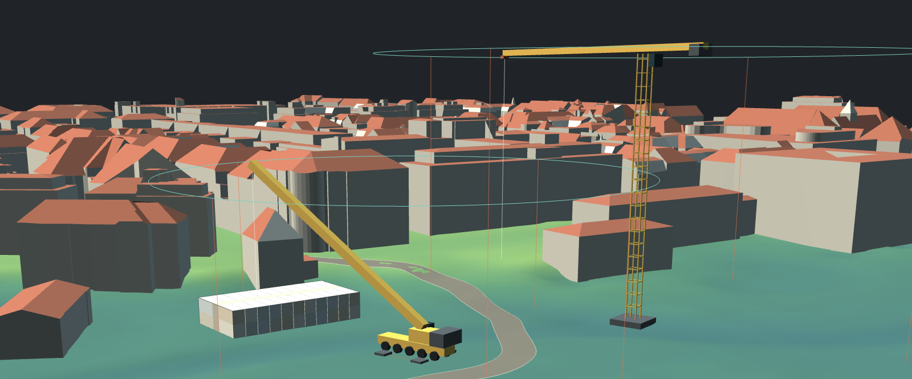

# Quick-Site-Design

*[Deutsche Fassung](README.md)*

A tool for the early stage of construction site layout. The official terrain
model of the site is loaded and populated with what actually goes on it: site
offices, tower cranes, mobile cranes, haul roads. Everything to scale,
everything on real elevations.

A crane position is set in two minutes and moved in two more. Immediately
visible: whether the radius reaches, whether two crane radii overlap, whether
the office block fits the available area, and how the haul road sits in the
terrain. It does not replace detailed design.

Technically one HTML file of roughly 150 KB plus three libraries next to it. No
server, no installation, no build step. Once opened, all data stays in the
browser.

**[→ Open the application](https://quick-site-design.com/)**

---

## What it does

**Geospatial data**
- GeoTIFF terrain models, several tiles at once. Pixels from all tiles are
  averaged into a common grid, so differing resolutions and overlaps are not a
  problem.
- CityGML LOD2, also as a batch. Axis order is detected automatically, buildings
  outside the tile are discarded.
- Terrain resolution adapts to zoom automatically: nearby parts at full data
  resolution (up to 1400 grid points per axis), distant parts coarser (tiles of
  64 × 64 cells). There is no slider for it. Height lookups, objects and the IFC
  export always use the same data.
- The coordinate reference system is read from the GeoKeys.

**Site elements**
- Container blocks up to 25 side by side, 2 rows, 5 storeys. With two rows a
  walkway one container wide is left between them, filled by a plain connecting
  block.
- Tower crane as a generic model, jib length, hook height and mast width
  freely adjustable within the range of real construction cranes.
- 24 Liebherr mobile cranes from 35 t to 750 t, all figures taken from the
  manufacturers' original data sheets, with the real axle count from the model name.
- Excavation as a polygon (right-click or space closes it): depth below the mean ground
  (default −5 m) and the bottom level are two sliders for the same value. Excavation and
  fill are shown in m³ in the properties window; the terrain gets a hole you can look into.
  The slope angle (20–90°, 90° = vertical) keeps the drawn outline as the top edge and
  only shrinks the floor.
- Optional: OpenStreetMap as a base map on the terrain (switch in the data window, off by default;
  turning it on makes the browser load tiles from tile.openstreetmap.org, which transmits the IP address).
- Haul roads as a polyline with filleted corners and a constant longitudinal
  slope (slider in %, preset from the start and end elevation on the terrain).
  Length and area are shown in the properties window. Where the carriageway
  lies above or below the terrain, an embankment joins it (1:1, 1:1.5 or 1:2, selectable); fill and cut are
  listed in m³ (average end area method). Selecting a road reveals its nodes,
  which can be moved, deleted or added to ("Add node" inserts one into the nearest segment).
  On request the road checks the swept path of a semi-trailer truck (16.50 m, driving on
  the road centre): swept area on the plan, required width and "fits / does not fit".

**Interaction**
- Mouse: drag with the left button = orbit, right or middle button = pan,
  wheel = zoom. Left-dragging from terrain, a building or a placed element
  orbits around exactly that point; dragging from the background orbits the whole
  scene around the view centre.
- Left-click on terrain or buildings sets a measure point, shows easting,
  northing and elevation right at the point, and makes it the orbit and zoom
  centre.
- **2D** button resets the view to straight from above; dragging tilts it back
  into space. The compass shows north and orients to it on click.
- Warning when crane radii overlap; the haul road radius slider turns red as
  soon as the minimum radius no longer fits between the nodes.
- Two interface styles (dark and light), eleven typefaces, German and English.

---

## Demo

**[→ Open the demo](https://quick-site-design.com/?demo=1)**

The link loads terrain and buildings automatically. After a few seconds a square
kilometre of real terrain with 612 buildings is ready — pick an element from the
bar at the bottom and click on the terrain.

The data set:

| File | Contents |
|---|---|
| `demo/demo_dgm.tif` | DTM, 1000 × 1000 points, 1 m grid, elevations 503.1 to 520.7 m |
| `demo/demo_lod2.gml` | LOD2 building model, 612 buildings, clipped to the tile |

ETRS89 / UTM zone 32N (EPSG:25832), south-west corner at E 692000 / N 5336000,
located at roughly 48.153 North and 11.588 East.

Own data goes in through the two file inputs under **Data**: terrain first, then
buildings.

The sample data originates from the Bavarian surveying authority
([geodaten.bayern.de](https://geodaten.bayern.de/opengeodata/OpenDataDetail.html?pn=dgm1)),
published under [CC BY 4.0](https://creativecommons.org/licenses/by/4.0/).
The attribution is displayed inside the application for as long as the sample
data is loaded.

---

## Important note on the crane data

The crane figures are **guide values**. They come from the manufacturers'
published data sheets, but they depend on the rigging configuration, tower
combination and ballasting.

**For actual planning, only the load chart of the specific crane is
authoritative.** This application does not replace structural verification,
stability calculations, or coordination with the crane hire company.

Outrigger dimensions and carrier lengths serve presentation only and are
schematic.

---

## Where to get the data

Not every German state offers the DGM1 as GeoTIFF, and not every portal
clearly publishes it as open data. The portals differ in format, tiling,
access and licence. The table lists the DGM1 and the 3D building model (LoD2)
per state; the links were checked in November 2026. A ⚠ in the format column
means: no GeoTIFF.

| State | Authority | DGM1 portal | DGM1 format | Building model (LoD2) | Licence (DGM1) |
|---|---|---|---|---|---|
| Baden-Württemberg | LGL-BW | [opengeodata.lgl-bw.de](https://opengeodata.lgl-bw.de/) | ⚠ XYZ text (GeoTIFF only for DGM025, 0.25 m) | [opengeodata.lgl-bw.de](https://opengeodata.lgl-bw.de/) (CityGML, 2 × 2 km) | dl-de/by-2-0 |
| Bavaria | Bavarian Surveying Administration | [geodaten.bayern.de](https://geodaten.bayern.de/opengeodata/OpenDataDetail.html?pn=dgm1) | GeoTIFF | [geodaten.bayern.de](https://geodaten.bayern.de/opengeodata/OpenDataDetail.html?pn=lod2) | cc-by/4.0 |
| Berlin | — | included in the Brandenburg data (not checked) | — | [gdi.berlin.de](https://gdi.berlin.de/geonetwork/srv/api/records/3c7c49af-00a4-3bcd-bc00-20e7f0f1b7bf) | — |
| Brandenburg | LGB | [data.geobasis-bb.de](https://data.geobasis-bb.de/geobasis/daten/) | GeoTIFF (also XYZ) | [data.geobasis-bb.de](https://data.geobasis-bb.de/geobasis/daten/3d_gebaeude/) | dl-de/by-2-0 |
| Bremen | LGV Bremen | [GDI-DE catalogue](https://gdk.gdi-de.org/geonetwork/srv/api/records/C448202A-0F15-413A-99E6-F22F10E190C9) | ⚠ XYZ ASCII | [geo.bremen.de](https://www.geo.bremen.de/produkte/3d-produkte/3d-gebaeudemodelle-11892) | cc-by/4.0 |
| Hamburg | LGV Hamburg | [metaver.de](https://metaver.de/trefferanzeige?docuuid=A39B4E86-15E2-4BF7-BA82-66F9913D5640) | ⚠ XYZ ASCII, 2 × 2 km (the 2022 package is labelled "PNG", not checked) | [metaver.de](https://metaver.de/trefferanzeige?docuuid=1F6E48EB-3B7B-4F61-AE3C-C03079ECCAEA) (GML) | dl-de/by-2-0 |
| Hesse | HVBG | [hvbg.hessen.de](https://hvbg.hessen.de/landesvermessung/geotopographie/3d-daten/digitale-gelaendemodelle) | GeoTIFF | [hvbg.hessen.de](https://hvbg.hessen.de/landesvermessung/geotopographie/3d-daten/3d-gebaeudemodelle) | dl-de/by-2-0 |
| Mecklenburg-Western Pomerania | LAiV MV | [laiv.geodaten-mv.de](https://laiv.geodaten-mv.de/afgvk/Geotopographie/Download?produkt=DGM1) | GeoTIFF | [laiv.geodaten-mv.de](https://laiv.geodaten-mv.de/afgvk/Geotopographie/Download?produkt=3DGbm) | dl-de/by-2-0 |
| Lower Saxony | LGLN | [ni-lgln-opengeodata.hub.arcgis.com](https://ni-lgln-opengeodata.hub.arcgis.com/pages/digitales-gel-ndemodell-dgm1) | GeoTIFF (COG) | [ni-lgln-opengeodata.hub.arcgis.com](https://ni-lgln-opengeodata.hub.arcgis.com/pages/3d-geb-udemodell-lod2) | cc-by/4.0 |
| North Rhine-Westphalia | Geobasis NRW | [opengeodata.nrw.de](https://www.opengeodata.nrw.de/produkte/geobasis/hm/dgm1_tiff/) | GeoTIFF | [opengeodata.nrw.de](https://www.opengeodata.nrw.de/produkte/geobasis/3dg/lod2_gml/) | dl-de/by-2-0 |
| Rhineland-Palatinate | LVermGeo RP | [geoshop.rlp.de](https://geoshop.rlp.de/opendata-dgm1.html) | ⚠ XYZ ASCII (per metadata, GeoTIFF only as an alternative) | [geoshop.rlp.de](https://geoshop.rlp.de/opendata-geb3dlo.html) | dl-de/by-2-0 |
| Saarland | LVGL-SL | [saarland.de/lvgl](https://www.saarland.de/lvgl/DE/themen-aufgaben/themen/geotopographie/digitalegelaendemodelle/digitalegelaendemodelle) | ⚠ unclear: the page describes the DGM1 but offers no download | — (INSPIRE services only, not confirmed as open data) | ⚠ contradictory: metadata says dl-de/by-2-0, other sources a paid download |
| Saxony | GeoSN | [geodaten.sachsen.de](https://www.geodaten.sachsen.de/downloadbereich-digitale-hoehenmodelle-4851.html) | GeoTIFF | [geodaten.sachsen.de](https://www.geodaten.sachsen.de/downloadbereich-digitale-3d-stadtmodelle-4875.html) | dl-de/by-2-0 |
| Saxony-Anhalt | LVermGeo ST | [lvermgeo.sachsen-anhalt.de](https://www.lvermgeo.sachsen-anhalt.de/de/gdp-dgm-dom-lsa.html) | GeoTIFF (XYZ optional) | [lvermgeo.sachsen-anhalt.de](https://www.lvermgeo.sachsen-anhalt.de/de/gdp-3d-gebaeudemodell.html) | dl-de/by-2-0 |
| Schleswig-Holstein | LVermGeo SH | [opendata.schleswig-holstein.de](https://opendata.schleswig-holstein.de/dataset/digitales-gelandemodell-1-dgm1) | ⚠ XYZ ASCII | [OpenGBD-Portal](https://www.schleswig-holstein.de/DE/landesregierung/ministerien-behoerden/LVERMGEOSH/Themen/themaOpenGbd) (LoD2 not checked) | cc-by/4.0 |
| Thuringia | TLBG | [tlbg.thueringen.de](https://tlbg.thueringen.de/geobasisdaten/3d-informationen/digitale-gelaendemodelle) | GeoTIFF (partly point clouds) | [tlbg.thueringen.de](https://tlbg.thueringen.de/geobasisdaten/3d-informationen/3d-gebaeudemodelle) | dl-de/by-2-0 |

**Format.** Quick-Site-Design expects GeoTIFF with elevation values as float
and a georeference in the header. GeoTIFF is offered by Bavaria, Brandenburg,
Hesse, Mecklenburg-Western Pomerania, Lower Saxony (as Cloud-Optimized
GeoTIFF), North Rhine-Westphalia, Saxony, Saxony-Anhalt and Thuringia.
Baden-Württemberg (DGM1 since March 2026), Bremen, Hamburg, Rhineland-Palatinate
and Schleswig-Holstein publish XYZ text, and in Saarland the offer is unclear.
That data has to be converted before loading, for example with GDAL.

**File size.** The tool reads each file completely into memory. It therefore
rejects, with a message and before reading, files over 1 GB, tiles over 100 million
pixels and more than 150 million pixels (2 GB) in total. This mainly concerns
Austria: the BEV 1 m rasters and the 10 m file for all of Austria are far larger.
Cut out an area first, for example with `gdal_translate -projwin`.

**Saarland.** The LVGL page describes the DGM1 but contains no download, and
the licence statements contradict each other. Until that is settled, "free as
open data" is not established for Saarland.

**Tiling.** Usually 1 × 1 km, sometimes 2 × 2 km. Several tiles can be selected
together and are merged on load.

**Building models.** The links in the "Building model (LoD2)" column lead to the
product page of each state; the data is CityGML, partly under different
licences. For Schleswig-Holstein the LoD2 offer is not confirmed, for Saarland
only services exist.

**Attribution.** The licences listed require a source statement. The exact
wording is in the metadata of the respective state.

### Austria

The data comes from the federal government and from individual states and
cities; there is no nationwide 3D building model. Only offers checked in
November 2026 are listed. Styria, Lower Austria, Carinthia and Vorarlberg were
not checked.

| Authority | Terrain model | Format | Building model (LoD2) | Licence |
|---|---|---|---|---|
| Federal (BEV) | [ALS height raster 1 m](https://www.bev.gv.at/Services/Produkte/Digitales-Gelaendehoehenmodell/ALS-Hoehenraster.html), download on data.bev.gv.at | GeoTIFF (COG), ⚠ EPSG:3035 | — | CC BY 4.0 |
| Federal (10 m) | [DGM Austria 10 m](https://www.data.gv.at/katalog/dataset/d88a1246-9684-480b-a480-ff63286b35b7) | GeoTIFF | — | CC BY 4.0 |
| Vienna | [Terrain model raster 1 m](https://www.data.gv.at/katalog/dataset/1eda4b16-05e3-43c3-b5b0-ef8276df0701) | GeoTIFF and ASCII | [Roof model LoD2.1](https://www.data.gv.at/katalog/dataset/86d88cae-ad97-4476-bae5-73488a12776d) | CC BY 4.0 |
| Tyrol | [DGM Tirol](https://www.data.gv.at/katalog/dataset/0454f5f3-1d8c-464e-847d-541901eb021a) | GeoTIFF (0.5 m, 5 m, 10 m), XYZ grid (1 m) | — | CC BY 4.0 |
| Salzburg | [DGM 1 m](https://www.data.gv.at/katalog/dataset/093d4dec-8397-4faf-b690-b8cbe9a9dc31) | TIF with world file and ASCII, per municipality | — | not checked |
| Upper Austria | [DGM 0.5 m](https://www.data.gv.at/katalog/dataset/68cfe491-7cdf-4781-a1f1-603cd0738abd) | GeoTIFF and XYZ, EPSG:31255 | — | CC BY 4.0 |
| Burgenland | [Elevation models and orthophotos](https://geodaten.bgld.gv.at/de/downloads/hoehenmodelle-orthofotos.html) | not checked | — | not checked |
| Linz (city) | — | — | [3D geodata LoD2 2018](https://www.data.gv.at/katalog/dataset/5f4440ca-90b7-4875-a0e4-bce7f8abb13e), Gauss-Krüger M31 | CC BY 4.0 |

The BEV delivers its height rasters in EPSG:3035 (ETRS89-LAEA). The base map
(OpenStreetMap) does not convert that system and switches itself off with a
message; the Gauss-Krüger systems MGI (EPSG:31254 to 31256) work.

Data from other countries works too, as long as the GeoTIFF carries a projected
coordinate system and the CityGML uses the same one.

---

## Repository layout

```
quick-site-design/
├── index.html            the application, built from src/
├── impressum.html        legal notice (German)
├── datenschutz.html      privacy policy (German)
├── README.md             German
├── README.en.md
├── PROJEKT.md            developer notes (German)
├── LICENSE
├── build.py
├── .gitignore
├── lib/
│   ├── three.min.js      libraries, local instead of CDN
│   ├── OrbitControls.js
│   ├── geotiff.js
│   └── LIESMICH.txt      which file comes from where
├── demo/
│   ├── demo_dgm.tif      terrain model for the demo link
│   ├── demo_lod2.gml     building model for the demo link
│   └── LIESMICH.txt      source and licence of the sample data
├── docs/
│   └── header.png        header image for the README
├── src/
│   ├── shell_head.html
│   ├── app.js
│   ├── ui.js
│   └── boot.js
└── test/
    ├── test.js
    ├── test-ui.js
    ├── validate-html.js
    ├── demo-check.js
    ├── three-stub.js
    └── xml-stub.js
```

`index.html` is assembled from the four files in `src/` with
`python3 build.py`. The tests in `test/` run under `node` and need no browser.
Details are in `PROJEKT.md` (German).

---

## Running it yourself

The application requires three libraries:

| Library | Licence |
|---|---|
| three.js r128 | MIT |
| OrbitControls (three.js examples) | MIT |
| geotiff.js 2.1.3 | MIT |

All three are compatible with the GPLv3 and live in the `lib/` folder. They are
**not** loaded from a CDN, so opening the page creates no connections to third
parties and the application also works offline.

The library files themselves are not part of the repository; their sources are
listed in [`lib/LIESMICH.txt`](lib/LIESMICH.txt) (German).

For operation on a private web space, `index.html` together with the `lib/` and
`demo/` folders in the web directory is sufficient. The `demo/` folder is only
needed for the demo link.

---

## Legal

[Impressum](impressum.html) · [Datenschutzerklärung](datenschutz.html)

Both pages are in German, as required for a site operated from Germany.

---

## Licence

Copyright © 2026 Haoran Li

GNU General Public License, version 3 or later. See [LICENSE](LICENSE).

In short: the software may be used, distributed and modified. A distributed
modified version must also be under the GPLv3, with its source available.

The software is provided without any warranty.
