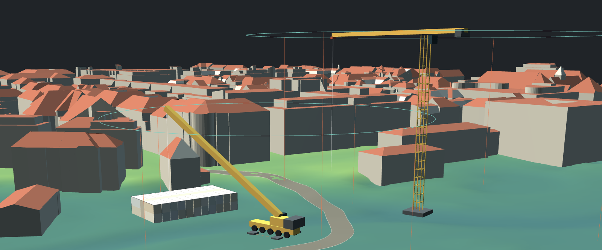

# Quick-Site-Design

*[Deutsche Fassung](README.md)* · *[User guide](USER-GUIDE.en.md)*

A tool for the early stage of construction site layout. The official terrain
model of the site is loaded and populated with what actually goes on it: site
offices, tower cranes, mobile cranes, haul roads. Everything to scale,
everything on real elevations.

A crane position is set in two minutes and moved in two more. Immediately
visible: whether the radius reaches, whether two crane radii overlap, whether
the office block fits the available area, and how the haul road sits in the
terrain. It does not replace detailed design.

Technically one HTML file of roughly 150 KB plus four libraries next to it. No
server, no installation, no build step. Once opened, all data stays in the
browser.

**[→ Open the application](https://quick-site-design.com/)**

---

## What it does

**Geospatial data**
- GeoTIFF terrain models, several tiles at once. Pixels from all tiles are
  averaged into a common grid, so differing resolutions and overlaps are not a
  problem.
- CityGML LOD2 and **CityJSON** (also CityJSONSeq and the feature lists of the 3DBAG API), also as a batch. For CityJSON the
  highest level of detail of each part is used. Axis order is detected automatically, buildings outside the tile are discarded.
- Terrain resolution adapts to zoom automatically: nearby parts at full data
  resolution (up to 1400 grid points per axis), distant parts coarser (tiles of
  64 × 64 cells). There is no slider for it. Height lookups, objects and the IFC
  export always use the same data.
- The coordinate reference system is read from the GeoKeys.
- Import a structure as an IFC file: if the file is georeferenced and uses the same CRS as the
  terrain, it is placed automatically. Otherwise a two-point procedure fixes it (two point pairs: one point on the
  structure and its match on the
  terrain; the structure always stays level).

**Site elements**
- Container blocks up to 25 side by side, 2 rows, 5 storeys. With two rows a
  walkway one container wide is left between them, filled by a plain connecting
  block.
- Tower crane as a generic model, jib length, hook height and mast width
  freely adjustable within the range of real construction cranes.
- 24 Liebherr mobile cranes from 35 t to 750 t, all figures taken from the
  manufacturers' original data sheets, with the real axle count from the model name.
- Excavation as a polygon (right-click or space closes it): depth below the mean ground
  (default −5 m) and the bottom level are two sliders for the same value. Excavation and
  fill are shown in m³ in the properties window; the terrain gets a hole you can look into.
  The slope angle (20–90°, 90° = vertical) keeps the drawn outline as the top edge and
  only shrinks the floor.
- Optional: OpenStreetMap as a base map on the terrain (“Map” button at the bottom left, off by default;
  turning it on makes the browser load tiles from tile.openstreetmap.org, which transmits the IP address).
- Haul roads as a polyline with filleted corners and a constant longitudinal
  slope (slider in %, preset from the start and end elevation on the terrain).
  Length and area are shown in the properties window. Where the carriageway
  lies above or below the terrain, an embankment joins it (1:1, 1:1.5 or 1:2, selectable); fill and cut are
  listed in m³ (average end area method). Selecting a road reveals its nodes,
  which can be moved, deleted or added to ("Add node" inserts one into the nearest segment).
  On request the road checks the swept path of a semi-trailer truck (16.50 m, driving on
  the road centre): swept area on the plan, required width and "fits / does not fit".

**Interaction**
- Mouse: drag with the left button = orbit, right or middle button = pan,
  wheel = zoom. Left-dragging from terrain, a building or a placed element
  orbits around exactly that point; dragging from the background orbits the whole
  scene around the view centre.
- **Measure** tool: click points on terrain or buildings; every segment shows its horizontal
  length and height difference (two decimals), plus totals, slope and heights.
- Left-click on terrain or buildings sets a measure point, shows easting,
  northing and elevation right at the point, and makes it the orbit and zoom
  centre.
- **2D** button resets the view to straight from above; dragging tilts it back
  into space. The compass shows north and orients to it on click.
- Warning when crane radii overlap; the haul road radius slider turns red as
  soon as the minimum radius no longer fits between the nodes.
- Dark interface on a light background, eleven typefaces, German and English.

---

## Demo

**[→ Open the demo](https://quick-site-design.com/?demo=1)**

The link loads terrain and buildings automatically. After a few seconds a square
kilometre of real terrain with 612 buildings is ready — pick an element from the
bar at the bottom and click on the terrain.

The data set:

| File | Contents |
|---|---|
| `demo/demo_dgm.tif` | DTM, 1000 × 1000 points, 1 m grid, elevations 503.1 to 520.7 m |
| `demo/demo_lod2.gml` | LOD2 building model, 612 buildings, clipped to the tile |

ETRS89 / UTM zone 32N (EPSG:25832), south-west corner at E 692000 / N 5336000,
located at roughly 48.153 North and 11.588 East.

Own data goes in through the two file inputs under **Data**: terrain first, then
buildings.

The sample data originates from the Bavarian surveying authority
([geodaten.bayern.de](https://geodaten.bayern.de/opengeodata/OpenDataDetail.html?pn=dgm1)),
published under [CC BY 4.0](https://creativecommons.org/licenses/by/4.0/).
The attribution is displayed inside the application for as long as the sample
data is loaded.

---

## Important note on the crane data

The crane figures are **guide values**. They come from the manufacturers'
published data sheets, but they depend on the rigging configuration, tower
combination and ballasting.

**For actual planning, only the load chart of the specific crane is
authoritative.** This application does not replace structural verification,
stability calculations, or coordination with the crane hire company.

Outrigger dimensions and carrier lengths serve presentation only and are
schematic.

---

## Where to get the data

Not every German state offers the DGM1 as GeoTIFF, and not every portal
clearly publishes it as open data. The portals differ in format, tiling,
access and licence. The table lists the DGM1 and the 3D building model (LoD2)
per state; the links were checked in November 2026. A ⚠ in the format column
means: no GeoTIFF (XYZ can be loaded directly).

| State | Authority | DGM1 portal | DGM1 format | Building model (LoD2) | Licence (DGM1) |
|---|---|---|---|---|---|
| Baden-Württemberg | LGL-BW | [opengeodata.lgl-bw.de](https://opengeodata.lgl-bw.de/) | ⚠ XYZ text (GeoTIFF only for DGM025, 0.25 m) | [opengeodata.lgl-bw.de](https://opengeodata.lgl-bw.de/) (CityGML, 2 × 2 km) | dl-de/by-2-0 |
| Bavaria | Bavarian Surveying Administration | [geodaten.bayern.de](https://geodaten.bayern.de/opengeodata/OpenDataDetail.html?pn=dgm1) | GeoTIFF | [geodaten.bayern.de](https://geodaten.bayern.de/opengeodata/OpenDataDetail.html?pn=lod2) | cc-by/4.0 |
| Berlin | — | included in the Brandenburg data (not checked) | — | [gdi.berlin.de](https://gdi.berlin.de/geonetwork/srv/api/records/3c7c49af-00a4-3bcd-bc00-20e7f0f1b7bf) | — |
| Brandenburg | LGB | [data.geobasis-bb.de](https://data.geobasis-bb.de/geobasis/daten/) | GeoTIFF (also XYZ) | [data.geobasis-bb.de](https://data.geobasis-bb.de/geobasis/daten/3d_gebaeude/) | dl-de/by-2-0 |
| Bremen | LGV Bremen | [GDI-DE catalogue](https://gdk.gdi-de.org/geonetwork/srv/api/records/C448202A-0F15-413A-99E6-F22F10E190C9) | ⚠ XYZ ASCII | [geo.bremen.de](https://www.geo.bremen.de/produkte/3d-produkte/3d-gebaeudemodelle-11892) | cc-by/4.0 |
| Hamburg | LGV Hamburg | [metaver.de](https://metaver.de/trefferanzeige?docuuid=A39B4E86-15E2-4BF7-BA82-66F9913D5640) | ⚠ XYZ ASCII, 2 × 2 km (the 2022 package is labelled "PNG", not checked) | [metaver.de](https://metaver.de/trefferanzeige?docuuid=1F6E48EB-3B7B-4F61-AE3C-C03079ECCAEA) (GML) | dl-de/by-2-0 |
| Hesse | HVBG | [hvbg.hessen.de](https://hvbg.hessen.de/landesvermessung/geotopographie/3d-daten/digitale-gelaendemodelle) | GeoTIFF | [hvbg.hessen.de](https://hvbg.hessen.de/landesvermessung/geotopographie/3d-daten/3d-gebaeudemodelle) | dl-de/by-2-0 |
| Mecklenburg-Western Pomerania | LAiV MV | [laiv.geodaten-mv.de](https://laiv.geodaten-mv.de/afgvk/Geotopographie/Download?produkt=DGM1) | GeoTIFF | [laiv.geodaten-mv.de](https://laiv.geodaten-mv.de/afgvk/Geotopographie/Beschreibung?produkt=3DGbm) | dl-de/by-2-0 |
| Lower Saxony | LGLN | [ni-lgln-opengeodata.hub.arcgis.com](https://ni-lgln-opengeodata.hub.arcgis.com/pages/digitales-gel-ndemodell-dgm1) | GeoTIFF (COG) | [ni-lgln-opengeodata.hub.arcgis.com](https://ni-lgln-opengeodata.hub.arcgis.com/pages/3d-geb-udemodell-lod2) | cc-by/4.0 |
| North Rhine-Westphalia | Geobasis NRW | [opengeodata.nrw.de](https://www.opengeodata.nrw.de/produkte/geobasis/hm/dgm1_tiff/) | GeoTIFF | [opengeodata.nrw.de](https://www.opengeodata.nrw.de/produkte/geobasis/3dg/lod2_gml/) | dl-de/by-2-0 |
| Rhineland-Palatinate | LVermGeo RP | [geoshop.rlp.de](https://geoshop.rlp.de/opendata-dgm1.html) | ⚠ XYZ ASCII (per metadata, GeoTIFF only as an alternative) | [geoshop.rlp.de](https://geoshop.rlp.de/opendata-geb3dlo.html) | dl-de/by-2-0 |
| Saarland | LVGL-SL | [saarland.de/lvgl](https://www.saarland.de/lvgl/DE/themen-aufgaben/themen/geotopographie/digitalegelaendemodelle/digitalegelaendemodelle) | ⚠ unclear: the page describes the DGM1 but offers no download | — (INSPIRE services only, not confirmed as open data) | ⚠ contradictory: metadata says dl-de/by-2-0, other sources a paid download |
| Saxony | GeoSN | [geodaten.sachsen.de](https://www.geodaten.sachsen.de/downloadbereich-digitale-hoehenmodelle-4851.html) | GeoTIFF | [geodaten.sachsen.de](https://www.geodaten.sachsen.de/downloadbereich-digitale-3d-stadtmodelle-4875.html) | dl-de/by-2-0 |
| Saxony-Anhalt | LVermGeo ST | [lvermgeo.sachsen-anhalt.de](https://www.lvermgeo.sachsen-anhalt.de/de/gdp-dgm-dom-lsa.html) | GeoTIFF (XYZ optional) | [lvermgeo.sachsen-anhalt.de](https://www.lvermgeo.sachsen-anhalt.de/de/gdp-3d-gebaeudemodell.html) | dl-de/by-2-0 |
| Schleswig-Holstein | LVermGeo SH | [opendata.schleswig-holstein.de](https://opendata.schleswig-holstein.de/dataset/digitales-gelandemodell-1-dgm1) | ⚠ XYZ ASCII | [OpenGBD-Portal](https://www.schleswig-holstein.de/DE/landesregierung/ministerien-behoerden/LVERMGEOSH/Themen/themaOpenGbd) (LoD2 not checked) | cc-by/4.0 |
| Thuringia | TLBG | [tlbg.thueringen.de](https://tlbg.thueringen.de/geobasisdaten/3d-informationen/digitale-gelaendemodelle) | GeoTIFF (partly point clouds) | [tlbg.thueringen.de](https://tlbg.thueringen.de/geobasisdaten/3d-informationen/3d-gebaeudemodelle) | dl-de/by-2-0 |

**Format.** Quick-Site-Design expects GeoTIFF with elevation values as float
and a georeference in the header. GeoTIFF is offered by Bavaria, Brandenburg,
Hesse, Mecklenburg-Western Pomerania, Lower Saxony (as Cloud-Optimized
GeoTIFF), North Rhine-Westphalia, Saxony, Saxony-Anhalt and Thuringia.
Baden-Württemberg (DGM1 since March 2026), Bremen, Hamburg, Rhineland-Palatinate
and Schleswig-Holstein publish XYZ text, and in Saarland the offer is unclear.
The application reads XYZ files (`.xyz`, `.txt`, `.csv`; easting, northing, height on a
regular grid) directly. They carry no coordinate system, so you choose it in the data
window or type the EPSG code. ESRI ASCII grids (`.asc`) are not read; convert them to
GeoTIFF with GDAL.

**File size.** Small GeoTIFF files are read completely into memory. **Files over 300 MB are not read completely, only the
area around the chosen place** (pin or address on the start map): `geotiff.js` then fetches only the header and the
blocks the window touches. For the BEV height raster (COG in EPSG:3035, 50 × 50 km, 7.9 GB) that is about 5 MB for 1 × 1 km and
roughly half a second; the values match GDAL. If there is no place, the place is not in the file or the area is larger than
100 million pixels, a message appears. Other limits before reading: files up to 300 MB at most 1 GB each, tiles over
100 million pixels and more than 150 million pixels (2 GB) in total. If you prefer to cut yourself: `gdal_translate -projwin`;
the start map gives the ready command for Austria (`-projwin_srs EPSG:4326`, fits any coordinate system).

**Saarland.** The LVGL page describes the DGM1 but contains no download, and
the licence statements contradict each other. Until that is settled, "free as
open data" is not established for Saarland.

**Tiling.** Usually 1 × 1 km, sometimes 2 × 2 km. Several tiles can be selected
together and are merged on load.

**Building models.** The links in the "Building model (LoD2)" column lead to the
product page of each state; the data is CityGML, partly under different
licences. For Schleswig-Holstein the LoD2 offer is not confirmed, for Saarland
only services exist.

**Attribution.** The licences listed require a source statement. The exact
wording is in the metadata of the respective state.

### Austria

The data comes from the federal government and from individual states and
cities; there is no nationwide 3D building model. Only offers checked in
November 2026 are listed. Styria, Lower Austria, Carinthia and Vorarlberg were
not checked.

| Authority | Terrain model | Format | Building model (LoD2) | Licence |
|---|---|---|---|---|
| Federal (BEV) | [ALS height raster 1 m](https://www.bev.gv.at/Services/Produkte/Digitales-Gelaendehoehenmodell/ALS-Hoehenraster.html), download on data.bev.gv.at | GeoTIFF (COG), ⚠ EPSG:3035 | — | CC BY 4.0 |
| Federal (10 m) | [DGM Austria 10 m](https://www.data.gv.at/katalog/dataset/d88a1246-9684-480b-a480-ff63286b35b7) | GeoTIFF | — | CC BY 4.0 |
| Vienna | [Terrain model raster 1 m](https://www.data.gv.at/katalog/dataset/1eda4b16-05e3-43c3-b5b0-ef8276df0701) | GeoTIFF and ASCII | [Roof model LoD2.1](https://www.data.gv.at/katalog/dataset/86d88cae-ad97-4476-bae5-73488a12776d) | CC BY 4.0 |
| Tyrol | [DGM Tirol](https://www.data.gv.at/katalog/dataset/0454f5f3-1d8c-464e-847d-541901eb021a) | GeoTIFF (0.5 m, 5 m, 10 m), XYZ grid (1 m) | — | CC BY 4.0 |
| Salzburg | [DGM 1 m](https://www.data.gv.at/katalog/dataset/093d4dec-8397-4faf-b690-b8cbe9a9dc31) | TIF with world file and ASCII, per municipality | — | not checked |
| Upper Austria | [DGM 0.5 m](https://www.data.gv.at/katalog/dataset/68cfe491-7cdf-4781-a1f1-603cd0738abd) | GeoTIFF and XYZ, EPSG:31255 | — | CC BY 4.0 |
| Burgenland | [Elevation models and orthophotos](https://geodaten.bgld.gv.at/de/downloads/hoehenmodelle-orthofotos.html) | not checked | — | not checked |
| Linz (city) | — | — | [3D geodata LoD2 2018](https://www.data.gv.at/katalog/dataset/5f4440ca-90b7-4875-a0e4-bce7f8abb13e), Gauss-Krüger M31 | CC BY 4.0 |

The BEV delivers its height rasters in EPSG:3035 (ETRS89-LAEA). The application knows this system (map, conversion in the
IFC export, checked against GDAL to 1 cm) and reads only the area around the chosen place from the huge BEV files. The
Gauss-Krüger systems MGI (EPSG:31254 to 31256) work as well.

Data from other countries works too, as long as the GeoTIFF carries a projected
coordinate system and the CityGML uses the same one.

### Other EU countries

Besides Germany and Austria, the address search names the pages for the terrain model and the building model of the other
EU countries. The basis are the pages of the national mapping agencies and the overview at
[maps3d.io/dataset](https://maps3d.io/dataset); all links answered in November 2026. **Only reachability and what the page
states were checked:** where the page itself names GeoTIFF it says “GeoTIFF”; otherwise “not clear” (check before
loading). Licence and resolution come from the providers' statements as listed by maps3d.io. Countries without a known open
terrain model are listed below without a link instead of guessing one. Many countries deliver in their own coordinate
system (for example EPSG:28992 in the Netherlands). The application knows UTM, Gauss-Krüger, MGI, ETRS89-LAEA and the national systems of Sweden (EPSG:3006), Finland (3067), Poland (2180, 2176 to 2179), Slovenia (3794), Luxembourg (2169), Portugal (3763), Latvia (3059), Lithuania (3346), Greece (2100), Croatia (3765), Ireland (2157), France (2154), Belgium (3812, 31370), Estonia (3301), the Netherlands (28992, 7415), Czechia and Slovakia (5514) (checked against GDAL/PROJ to a few
millimetres; for systems with a datum shift, namely Luxembourg, the Netherlands, Belgium (31370), Greece, Czechia and Slovakia, the position is accurate to
about 1 m). The map and the conversion in the IFC export work for these systems. Not known are for example Hungary (EOV), Romania (Stereo 70),
Bulgaria and Cyprus; there the map switches itself off with a message.

| Country | Terrain model | Format | Building model | Licence (terrain) |
|---|---|---|---|---|
| Belgium | [Flanders · 1 m](https://www.vlaanderen.be/datavindplaats/catalogus/digitaal-hoogtemodel-vlaanderen-ii-dtm-raster-1-m), [Wallonia · 0.5 m](https://geoportail.wallonie.be/catalogue/a004e570-99d6-4fe5-b83d-49b774409278.html) | GeoTIFF | — | Flanders: model licence for free reuse; Wallonia: CC BY 4.0 |
| Cyprus | [Cyprus · 1 m](https://www.data.gov.cy/el/dataset/ypsometria-inspire) | not clear | — | CC BY 4.0 |
| Czechia | [ČÚZK DMR 4G · 5 m](https://geoportal.cuzk.cz/) | not clear | — | CC BY 4.0 |
| Denmark | [Højdemodel Terræn · 0.4 m](https://dataforsyningen.dk/data/930) | not clear | — | CC BY 4.0 |
| Estonia | [Maa-amet · 1 m](https://geoportaal.maaruum.ee/eng/spatial-data/elevation-data-p308.html) | GeoTIFF (also ASCII, XYZ) | — | open data licence of the agency |
| Finland | [Maanmittauslaitos · 2 m](https://www.maanmittauslaitos.fi/en/maps-and-spatial-data/datasets-and-interfaces/product-descriptions/elevation-model-2-m) | GeoTIFF (also ASCII) | — | CC BY 4.0 |
| France | [MNT LiDAR HD · 0.5 m](https://www.data.gouv.fr/datasets/mnt-lidar-hd) (not everywhere), [RGE ALTI · 1 m](https://geoservices.ign.fr/rgealti) | GeoTIFF / not clear | [IGN LiDAR HD, 3D buildings](https://www.ign.fr/institut/programme-lidar-hd-vers-une-nouvelle-cartographie-3d-du-territoire) (LoD2, beta, not everywhere) | Licence Ouverte 2.0 |
| Ireland | [GSI Open LiDAR · 0.13 to 2 m](https://data.gov.ie/en_GB/dataset/open-topographic-lidar-data) (not everywhere) | GeoTIFF | — | CC BY 4.0 |
| Italy | [TINITALY · 10 m](https://tinitaly.pi.ingv.it/Download_Area1_1.html), [South Tyrol · 2.5 m](https://natur-raum.provinz.bz.it/de/digitale-hohenmodelle) (only for places in the province of Bolzano) | not clear | — | TINITALY: CC BY 4.0 |
| Croatia | [DGU Digitalni model reljefa (WMS)](https://data.gov.hr/ckan/en/dataset/digitalni-model-reljefa) | web service (WMS) only, no download found | — | open licence (Otvorena dozvola) |
| Latvia | [LĢIA · 20 m](https://www.lgia.gov.lv/en/Digit%C4%81lais%20reljefa%20modelis) | not clear | — | CC BY 4.0 |
| Luxembourg | [LiDAR 2019 · 0.5 m](https://data.public.lu/fr/datasets/lidar-2019-modele-numerique-de-terrain-mnt/) | GeoTIFF, EPSG:2169 | [BD-L-BATI3D](https://data.public.lu/en/datasets/base-de-donnees-nationale-des-batiments-3d-2023/) (LoD2, CityGML) | CC0 |
| Malta | [DTM 2018 · 1 m](https://portal.data.gov.mt/dataset/digital-terrain-model-2018) | not clear (download and WCS) | — | not stated |
| Netherlands | [AHN · 0.5 m](https://www.ahn.nl/dataroom), [PDOK download DTM · 0.5 m](https://service.pdok.nl/rws/ahn/atom/dtm_05m.xml) | GeoTIFF (COG), EPSG:28992 | [3DBAG](https://3dbag.nl/en/download) (LoD2.2; **CityJSON can be loaded**, GeoPackage and OBJ cannot) | CC0 |
| Poland | [GUGiK NMT · 1 m and 5 m](https://www.geoportal.gov.pl/) | not clear | — | Open Government Data |
| Portugal | [DGT LiDAR, mainland · 0.5 m](https://cdd.dgterritorio.gov.pt/dgt-fe/catalogos/colecoes?filter=LiDAR+-+Modelos+Digitais+do+Relevo&language=en) | not clear | — | CC BY 4.0 |
| Romania | [ANCPI LAKI II · 0.5 m (partly)](https://geoportal.ancpi.ro/portal/apps/webappviewer/index.html?id=3f34ee5af71c400396dda574f0d53274) | not clear, page unreachable when checked | — | OGL-ROU-1.0 |
| Slovakia | [ÚGKK DMR 5.0 · 1 m](https://geoportal.gov.sk/gallery/datasets/detail/c310bf1e-68a0-43b9-9955-c7dad13a93aa) | not clear | — | CC BY 4.0 |
| Slovenia | [ARSO DMR · 1 m](https://gis.arso.gov.si/evode/) | not clear | — | CC BY 4.0 |
| Spain | [CNIG MDT02 · 2 m](https://centrodedescargas.cnig.es/CentroDescargas/modelo-digital-terreno-mdt02-segunda-cobertura) (not everywhere), [CNIG MDT05 · 5 m](https://centrodedescargas.cnig.es/CentroDescargas/modelo-digital-terreno-mdt05-primera-cobertura) | GeoTIFF | — | CC BY 4.0 |
| Sweden | [Lantmäteriet · 1 m](https://www.lantmateriet.se/sv/geodata/vara-produkter/produktlista/markhojdmodell-nedladdning/) | not clear | — | CC0 |

For **Bulgaria, Greece, Hungary and Lithuania** no verifiable open terrain model was found, so no link is
listed; the national geoportal or the EU INSPIRE geoportal help there. (Bulgaria: the ministry of agriculture names a download
service for orthophotos and an elevation model, but I found no page that proves it. Greece: the cadastre names elevation models,
distribution seems restricted.) An official 3D building model was found only in Luxembourg, the Netherlands and (partly)
France. Notes and corrections are welcome.

### City geoportals

Many capitals and large cities run their own geoportal or open-data portal, often with finer data than the state
(city map, cadastre extract, aerial photos, sometimes a 3D city model). The address search and the pin on the start map list them
in addition to the state's pages as soon as the found city is in this table (matched by city name and country).
The table stands on its own in `GEO_CITIES` (`src/app.js`). Compiled in November 2026; **every link was opened**.
Only that the page is reachable and shows a portal of the city is checked, not which data formats it offers. Three sites
(Tallinn, Vilnius, The Hague) answer automated requests only with a bot block; there a search confirms the address. Cities for which
no verifiable link was found (for example Budapest, Bucharest, Seville, Gdańsk, Malmö) are not listed instead of guessing one.
The list is not complete; notes and additions are welcome.

| City | Country | Map / geoportal | 3D city model | Open data / downloads |
|---|---|---|---|---|
| Vienna | Austria | [Geodatenviewer der Stadtvermessung Wien](https://www.wien.gv.at/ma41datenviewer/public/start.aspx) | — | [Geodaten der MA 41](https://www.wien.gv.at/stadtplanung/ma41-geodaten), [Open Government Data Wien](https://www.data.gv.at/auftritte/stadt-wien) |
| Graz | Austria | — | — | [Open Government Data Graz](https://www.data.gv.at/auftritte/stadt-graz) |
| Linz | Austria | [WebGIS Linz](https://www.linz.at/stadtentwicklung/webgis.php) | — | [Open Government Data Linz](https://www.data.gv.at/auftritte/stadt-linz) |
| Salzburg | Austria | [Stadtplan Salzburg](https://maps.stadt-salzburg.at/) | [3D-Stadtmodell Salzburg](https://maps.stadt-salzburg.at/3d/) | — |
| Innsbruck | Austria | [geoHub Innsbruck](https://geohub-1-magibk.hub.arcgis.com/) | — | — |
| Brussels | Belgium | [Geoportal der Stadt Brüssel](https://www.brussels.be/geoportal) | — | [UrbIS (Region Brüssel-Hauptstadt)](https://be.brussels/en/about-region/urbis-data), [Datastore Brussels](https://datastore.brussels/), [opendata.brussels.be](https://opendata.brussels.be/pages/home/) |
| Antwerp | Belgium | — | — | [Stad Antwerpen](https://portaal-stadantwerpen.opendata.arcgis.com/) |
| Ghent | Belgium | — | — | [Open Data Stad Gent](https://data.stad.gent/explore/) |
| Sofia | Bulgaria | [Sofiaplan](https://sofiaplan.bg/) | — | — |
| Zagreb | Croatia | [GeoPortal Zagreb](https://geoportal.zagreb.hr/) | — | [Portal otvorenih podataka](https://data.zagreb.hr/) |
| Prague | Czechia | [Geoportal Praha](https://geoportalpraha.cz/) | — | [Otevřená data Praha](https://lkod.cz/catalog/praha) |
| Brno | Czechia | [Mapový portál Brno](https://gis.brno.cz/) | — | [data.Brno](https://data.brno.cz/) |
| Copenhagen | Denmark | [KBHkort](https://kbhkort.kk.dk/) | — | [Københavns Kommune (opendata.dk)](https://www.opendata.dk/city-of-copenhagen) |
| Aarhus | Denmark | — | — | [Aarhus Kommune (opendata.dk)](https://www.opendata.dk/city-of-aarhus) |
| Tallinn | Estonia | [Tallinn Geoportal](https://www.tallinn.ee/en/tallinn-geoportal) | — | — |
| Helsinki | Finland | [Karttapalvelu Helsinki](https://kartta.hel.fi/) | [3D-Stadtmodell Helsinki](https://kartta.hel.fi/3d/) | [Helsinki Region Infoshare](https://hri.fi/fi/) |
| Espoo | Finland | [Espoon karttapalvelu](https://kartat.espoo.fi/ims) | — | — |
| Tampere | Finland | — | — | [Tampere Region Infoshare](https://data.tampere.fi/fi/) |
| Paris | France | — | — | [Paris Data](https://opendata.paris.fr/pages/home/) |
| Marseille | France | — | — | [Open Data Métropole Aix-Marseille-Provence](https://data.ampmetropole.fr/pages/accueil/) |
| Lyon | France | — | — | [data.grandlyon.com](https://data.grandlyon.com/portail/fr/) |
| Toulouse | France | — | — | [Toulouse Métropole Open Data](https://data.toulouse-metropole.fr/pages/accueil/) |
| Nice | France | — | — | [OpenData Nice Côte d’Azur](https://opendata.nicecotedazur.org/site) |
| Nantes | France | — | — | [Open Data Nantes Métropole](https://data.nantesmetropole.fr/pages/home/) |
| Strasbourg | France | — | — | [data.strasbourg.eu](https://data.strasbourg.eu/pages/accueil/) |
| Bordeaux | France | — | — | [Bordeaux Métropole Open Data](https://opendata.bordeaux-metropole.fr/pages/accueil/) |
| Lille | France | — | — | [dataMEL (Métropole Européenne de Lille)](https://data.lillemetropole.fr/accueil/) |
| Rennes | France | — | — | [Open Data Rennes Métropole](https://data.rennesmetropole.fr/explore/) |
| Montpellier | France | — | — | [Montpellier Méditerranée Métropole](https://data.montpellier3m.fr/) |
| Berlin | Germany | [Geoportal Berlin](https://gdi.berlin.de/viewer/main/) | [3D-Downloadportal Berlin](https://www.businesslocationcenter.de/berlin3d-downloadportal/) | [Geoinformation (Senatsverwaltung)](https://www.berlin.de/sen/stadt/stadtdaten/geoinformation/) |
| Hamburg | Germany | [Geoportal Hamburg](https://geoportal-hamburg.de/) | — | [Transparenzportal Hamburg](https://transparenz.hamburg.de/) |
| Munich | Germany | [GeoPortal München](https://stadt.muenchen.de/infos/geoportal-muenchen.html) | — | [Open Data Portal München](https://opendata.muenchen.de/) |
| Cologne | Germany | [Geoportal Köln](https://geoportal.stadt-koeln.de/) | — | — |
| Frankfurt am Main | Germany | [Geoportal Frankfurt](https://geoportal.frankfurt.de/karte/) | — | [Offene Daten Frankfurt](https://offenedaten.frankfurt.de/) |
| Stuttgart | Germany | [Geoportal Stuttgart](https://www.stuttgart.de/leben/bauen/geoportal/) | — | [OpenData@Stuttgart](https://opendata.stuttgart.de/) |
| Düsseldorf | Germany | [Geoportal Düsseldorf](https://www.duesseldorf.de/geoportal/) | — | — |
| Leipzig | Germany | [Stadtplan Leipzig](https://www.leipzig.de/stadtplan) | — | [Open Data Leipzig](https://opendata.leipzig.de/) |
| Dortmund | Germany | [Geoportal Dortmund](https://www.dortmund.de/allgemeines/geoportal-stadtplan/) | — | [Open Data Dortmund](https://open-data.dortmund.de/pages/start/) |
| Essen | Germany | [Geoportal Essen](https://geoportal.essen.de/) | — | — |
| Bremen | Germany | [GeoPortal Bremen](https://geoportal.bremen.de/geoportal/) | — | — |
| Dresden | Germany | [Themenstadtplan Dresden](https://stadtplan.dresden.de/) | — | [Open Data Dresden](https://opendata.dresden.de/) |
| Hanover | Germany | — | — | [Open GeoData Hannover](https://www.hannover.de/Leben-in-der-Region-Hannover/Verwaltungen-Kommunen/Die-Verwaltung-der-Landeshauptstadt-Hannover/Dezernate-und-Fachbereiche-der-LHH/Stadtentwicklung-und-Bauen/Fachbereich-Planen-und-Stadtentwicklung/Geoinformation/Open-GeoData) |
| Nuremberg | Germany | [GeoPortal Nürnberg](https://www.nuernberg.de/internet/geoinformation_bodenordnung/geoportal_landingpage.html) | — | — |
| Athens | Greece | [Athens Maps](https://maps.cityofathens.gr/) | — | — |
| Dublin | Ireland | — | — | [Dublin’s Open Data Portal](https://data.smartdublin.ie/) |
| Rome | Italy | [Geoportale di Roma Capitale](https://geoportale.comune.roma.it/) | — | — |
| Milan | Italy | [Geoportale Comune di Milano](https://gisportal.comune.milano.it/) | — | [Portale del Dato Milano](https://dati.comune.milano.it/web/portale-del-dato) |
| Turin | Italy | [Geoportale Città di Torino](http://geoportale.comune.torino.it/) | — | — |
| Naples | Italy | [Visore urbanistico Napoli](https://servizionline.comune.napoli.it/web/napoli/visore-urbanistico) | — | — |
| Genoa | Italy | [Cartografia Comune di Genova](https://www.comune.genova.it/tutti-gli-argomenti/cartografia) | — | — |
| Bologna | Italy | — | — | [Open Data Comune di Bologna](https://opendata.comune.bologna.it/pages/home/) |
| Florence | Italy | — | — | [Open Data Comune di Firenze](https://opendata.comune.fi.it/) |
| Palermo | Italy | — | — | [Portale Open Data Palermo](https://opendata.comune.palermo.it/) |
| Riga | Latvia | [GEO RĪGA](https://georiga.eu/) | — | — |
| Vilnius | Lithuania | [Interaktive Karten Vilnius](https://maps.vilnius.lt/en) | — | — |
| Kaunas | Lithuania | [Kauno žemėlapiai](https://zemelapiai.kaunas.lt/) | — | — |
| Amsterdam | Netherlands | [Maps Amsterdam](https://maps.amsterdam.nl/) | — | [Data Amsterdam](https://data.amsterdam.nl/) |
| Rotterdam | Netherlands | [Rotterdam op de kaart](https://kaartlaag.rotterdam.nl/) | [3D Rotterdam](https://www.3drotterdam.nl/) | [Rotterdam Open Data](https://data.rotterdam.nl/pages/home/) |
| The Hague | Netherlands | — | — | [Den Haag en open data](https://www.denhaag.nl/opendata) |
| Utrecht | Netherlands | — | — | [Open Utrecht](https://open.utrecht.nl/) |
| Warsaw | Poland | [Serwis Mapowy Warszawa](https://mapa.um.warszawa.pl/) | — | — |
| Kraków | Poland | [MSIP Kraków](https://msip.um.krakow.pl/) | — | — |
| Łódź | Poland | [InterSIT Łódź](https://nowa.mapa.lodz.pl/) | — | — |
| Wrocław | Poland | [SIP Wrocław](https://geoportal.wroclaw.pl/) | — | — |
| Poznań | Poland | [Geoportal Poznań](https://www.poznan.pl/mim/info/geoportal/) | — | — |
| Lisbon | Portugal | — | — | [Geodados da Câmara Municipal de Lisboa](https://geodados-cml.hub.arcgis.com/) |
| Porto | Portugal | — | — | [Portal de Dados Abertos Porto](https://dadosabertos.cm-porto.pt/) |
| Bratislava | Slovakia | — | — | [OpenData Bratislava](https://data.bratislava.sk/) |
| Ljubljana | Slovenia | — | — | [Odprti podatki Mestne občine Ljubljana](https://mol-ljubljana.hub.arcgis.com/) |
| Madrid | Spain | [Geoportal Ayuntamiento de Madrid](https://geoportal.madrid.es/IDEAM_WBGEOPORTAL/index.iam) | — | [Portal de datos abiertos Madrid](https://datos.madrid.es/) |
| Barcelona | Spain | [CartoBCN](https://w20.bcn.cat/cartobcn/) | — | [Open Data BCN](https://opendata-ajuntament.barcelona.cat/) |
| Valencia | Spain | [GeoportalHome Valencia](https://geoportal.valencia.es/apps/GeoportalHome/es/inicio/) | — | — |
| Zaragoza | Spain | [IDEZar Zaragoza](https://www.zaragoza.es/sede/portal/espacio-de-datos/conoce-idezar) | — | — |
| Málaga | Spain | — | — | [Datos abiertos Málaga](https://datosabiertos.malaga.eu/) |
| Stockholm | Sweden | — | — | [Dataportalen Stockholm](https://dataportalen.stockholm.se/dataportalen/srv/swe/catalog.search) |
| Gothenburg | Sweden | — | — | [Göteborgs Stad öppna data](https://data.goteborg.se/) |

---

## Repository layout

```
quick-site-design/
├── index.html            the application, built from src/
├── impressum.html        legal notice (German)
├── datenschutz.html      privacy policy (German)
├── README.md             German
├── README.en.md
├── BENUTZERANLEITUNG.md  user guide (German), the Help button links to it
├── USER-GUIDE.en.md      user guide (English)
├── PROJEKT.md            developer notes (German)
├── CHANGELOG.en.md       changelog (CHANGELOG.md: German)
├── CONTRIBUTING.md       contributing; CODE_OF_CONDUCT.md, SECURITY.md
├── THIRD-PARTY-NOTICES.md  third-party software, data, trademarks
├── LICENSE
├── .github/              issue and pull request templates
├── build.py
├── .gitignore
├── lib/
│   ├── three.min.js      libraries, local instead of CDN
│   ├── OrbitControls.js
│   ├── geotiff.js
│   ├── web-ifc-api-iife.js   IFC reader (loaded only on the first IFC import)
│   ├── web-ifc.wasm
│   ├── LICENSE-web-ifc.txt
│   └── LIESMICH.txt      which file comes from where
├── demo/
│   ├── demo_dgm.tif      terrain model for the demo link
│   ├── demo_lod2.gml     building model for the demo link
│   └── LIESMICH.txt      source and licence of the sample data
├── docs/
│   └── header.png        header image for the README
├── src/
│   ├── shell_head.html
│   ├── app.js
│   ├── ui.js
│   └── boot.js
└── test/
    ├── test.js
    ├── test-ui.js
    ├── validate-html.js
    ├── demo-check.js
    ├── three-stub.js
    └── xml-stub.js
```

`index.html` is assembled from the four files in `src/` with
`python3 build.py`. The tests in `test/` run under `node` and need no browser.
Details are in `PROJEKT.md` (German).

---

## Running it yourself

The application requires four libraries:

| Library | Licence |
|---|---|
| three.js r128 | MIT |
| OrbitControls (three.js examples) | MIT |
| geotiff.js 2.1.3 | MIT |
| web-ifc 0.0.79 (IFC import only) | MPL-2.0 |

All four are compatible with the GPLv3 and live in the `lib/` folder. They are
**not** loaded from a CDN, so opening the page creates no connections to third
parties and the application also works offline.

The library files themselves are not part of the repository; their sources are
listed in [`lib/LIESMICH.txt`](lib/LIESMICH.txt) (German).

For operation on a private web space, `index.html` together with the `lib/` and
`demo/` folders in the web directory is sufficient. The `demo/` folder is only
needed for the demo link.

---

## Contributing

Contributions are welcome: [CONTRIBUTING.md](CONTRIBUTING.md) (reporting bugs, contributing code, certificate of origin),
[code of conduct](CODE_OF_CONDUCT.md), [security policy](SECURITY.md), [changelog](CHANGELOG.en.md) and
[third-party software and trademarks](THIRD-PARTY-NOTICES.md). Manufacturer and model names (for example Liebherr) are used
only for identification; there is no affiliation with the manufacturers.

---

## Legal

[Impressum](impressum.html) · [Datenschutzerklärung](datenschutz.html)

Both pages are in German, as required for a site operated from Germany.

---

## Licence

Copyright © 2026 Haoran Li

GNU General Public License, version 3 or later. See [LICENSE](LICENSE).

In short: the software may be used, distributed and modified. A distributed
modified version must also be under the GPL (version 3 or later), with its source available.

The software is provided without any warranty. The results are rough aids and replace
neither design nor structural analysis nor surveying. The author's liability is excluded
to the extent permitted by law (see the [legal notice](impressum.html), in German).
