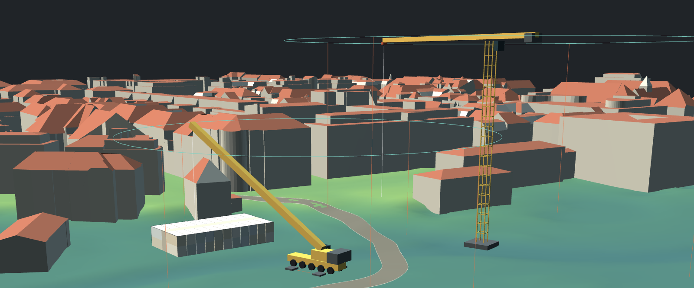

# Quick-Site-Design

*[English version](README.en.md)* · *[Benutzeranleitung](BENUTZERANLEITUNG.md)*

Werkzeug für die frühe Phase der Baustelleneinrichtung. Das amtliche
Geländemodell des Bauplatzes wird geladen und darauf gestellt, was wirklich
draufsteht: Container, Turmdrehkrane, Mobilkrane, Baustraßen. Alles maßstäblich,
alles auf echter Höhenlage.

Eine Kranaufstellung ist in zwei Minuten gesetzt und in weiteren zwei
umgestellt. Auf einen Blick sichtbar: ob die Ausladung reicht, ob sich zwei
Kranradien überschneiden, ob die Containeranlage auf die verfügbare Fläche passt
und wie die Baustraße im Gelände liegt. Eine Ausführungsplanung ersetzt das
nicht.

Technisch eine HTML-Datei von rund 150 KB und fünf Bibliotheken daneben. Kein
Server, keine Installation, kein Build. Nach dem Öffnen bleiben alle Daten im
Browser.

**[→ Anwendung öffnen](https://quick-site-design.com/)**

---

## Funktionsumfang

**Geobasisdaten**
- GeoTIFF- und XYZ-Geländemodelle (bei XYZ mit Wahl des EPSG-Codes) sowie **Punktwolken (LAS, LAZ)**, aus denen die Geländepunkte zu einem Raster gemittelt werden; mehrere Kacheln gleichzeitig. Die Pixel aller Kacheln
  werden in ein gemeinsames Raster gemittelt, unterschiedliche Auflösungen und
  Überlappungen sind daher unkritisch.
- CityGML LOD2 und **CityJSON** (auch CityJSONSeq und die Merkmalslisten der 3DBAG-Schnittstelle), ebenfalls als Stapel. Bei
  CityJSON gilt je Bauteil die höchste Detailstufe. Die Achsenreihenfolge wird erkannt, Gebäude außerhalb der Kachel verworfen.
- **2D-Gebäudedaten mit Höhenattributen:** GeoPackage (auch mehrere GB, gelesen wird nur der Ausschnitt um das Gelände), Shapefile (`.shp` mit `.dbf`, `.prj`) und GeoJSON.
  Die Grundrisse werden zu Quadern mit Flachdach (LoD1, Innenhöfe bleiben frei). Gelände- und Gebäudehöhe wählt man nach dem Laden aus den Attributen
  (oder gibt feste Werte an); das Bezugssystem kommt aus der Datei und lässt sich ändern. Geprüft an der BEV-Datei „DLM Bauwerke“ (2,5 GB).
- Die Geländeauflösung passt sich automatisch dem Zoom an: nahe Teile in voller
  Datenauflösung (bis 1400 Stützpunkte je Achse), ferne gröber (Kacheln zu
  64 × 64 Zellen). Es gibt keinen Regler dafür. Höhenabfragen, Objekte und
  IFC-Export nutzen immer dieselben Daten.
- Koordinatenbezugssystem wird aus den GeoKeys gelesen.
- Bauwerk als IFC-Datei einlesen: Ist die Datei georeferenziert und hat dasselbe Bezugssystem wie das
  Gelände, wird sie automatisch platziert. Sonst legt man sie in einem Zwei-Punkt-Verfahren fest
  (zwei Punktpaare: je ein Punkt am Bauwerk und der zugehörige im Gelände; das Bauwerk steht dabei immer waagerecht).

**Bausteine**
- Containeranlagen bis 25 nebeneinander, 2 Reihen, 5 Stockwerke. Bei zwei Reihen
  bleibt dazwischen ein Gang von einer Containerbreite, ausgefüllt von einem
  schlichten Verbindungsbau.
- Turmdrehkran als generisches Modell, Auslegerlänge, Hakenhöhe und Turmbreite
  frei einstellbar innerhalb der Bandbreite realer Baukrane.
- 24 Liebherr-Mobilkrane von 35 t bis 750 t, sämtliche Kennwerte aus den
  Original-Datenblättern, mit der echten Achszahl aus der Modellbezeichnung.
- Baugrube als Polygon (Rechtsklick oder Leertaste schließt): Tiefe zum mittleren Gelände
  (Standard −5 m) und Höhe der Unterkante sind zwei Regler für denselben Wert. Aushub
  und Aufschüttung stehen in m³ im Eigenschaftsfenster; im Gelände entsteht ein Loch,
  in das man hineinsieht. Der Böschungswinkel (20–90°, 90° = senkrecht) lässt die
  gezeichnete Kante oben stehen und verkleinert nur die Sohle.
- Optional: OpenStreetMap als Kartengrundlage auf dem Gelände (Knopf „Karte“ unten links, standardmäßig aus;
  beim Einschalten lädt der Browser Kacheln von tile.openstreetmap.org, die IP-Adresse wird dabei übertragen).
- Baustraßen als Polygonzug mit ausgerundeten Ecken und konstanter Längsneigung
  (Regler in %, vorbelegt aus Anfangs- und Endhöhe im Gelände). Länge und Fläche
  stehen im Eigenschaftsfenster. Wo die Fahrbahn über oder unter dem Gelände
  liegt, schließt eine Böschung an (1:1, 1:1,5 oder 1:2 wählbar); Auftrag und Abtrag erscheinen in m³
  (Mittelflächenverfahren). Bei Auswahl erscheinen die Stützpunkte und lassen
  sich versetzen, löschen oder ergänzen („Punkt hinzufügen“ fügt ihn in die nächste Strecke ein).
  Auf Wunsch prüft die Straße die Schleppkurve eines Sattelzugs (16,50 m, Fahrt auf der
  Straßenmitte): überstrichene Fläche im Plan, benötigte Breite und „passt / passt nicht“.

**Bedienung**
- Maus: linke Taste ziehen = umkreisen, rechte oder mittlere Taste ziehen =
  verschieben, Mausrad = zoomen. Wer links auf Gelände, Gebäude oder einen
  Baustein klickt und zieht, dreht um genau diesen Punkt; wer auf den Hintergrund
  klickt, kreist die ganze Szene um das Drehzentrum.
- Werkzeug **Messen**: Punkte auf Gelände oder Gebäuden anklicken, an jeder Strecke stehen
  waagerechte Länge und Höhenunterschied (zwei Nachkommastellen), dazu Summen, Gefälle und Höhen.
- Linksklick auf Gelände oder Gebäude setzt einen Messpunkt, zeigt Rechtswert,
  Hochwert und Höhe direkt am Punkt und macht ihn zum Dreh- und Zoomzentrum.
- **2D**-Knopf setzt die Ansicht senkrecht von oben; ein Ziehen kippt sie wieder
  frei in den Raum. Der Kompass zeigt die Nordrichtung und richtet auf Klick
  danach aus.
- Warnung bei sich überschneidenden Kranradien; der Radiusregler der Baustraße
  färbt sich, sobald der Mindestradius nicht mehr zwischen die Stützpunkte passt.
- Dunkle Oberfläche auf hellem Hintergrund, elf Schriftarten, Deutsch und Englisch.

---

## Demo

**[→ Demo öffnen](https://quick-site-design.com/?demo=1)**

Der Link lädt Gelände und Gebäude automatisch. Nach wenigen Sekunden steht ein
Quadratkilometer echtes Gelände mit 612 Gebäuden bereit — Baustein aus der
Leiste unten wählen und ins Gelände klicken.

Der Datensatz:

| Datei | Inhalt |
|---|---|
| `demo/demo_dgm.tif` | DGM1, 1000 × 1000 Punkte, 1 m Raster, Höhen 503,1 bis 520,7 m |
| `demo/demo_lod2.gml` | LoD2-Gebäudemodell, 612 Gebäude, auf die Kachel zugeschnitten |

ETRS89 / UTM Zone 32N (EPSG:25832), Südwestecke bei E 692000 / N 5336000,
gelegen bei etwa 48,153 Nord und 11,588 Ost.

Eigene Daten kommen über die beiden Dateifelder unter **Daten** hinein: zuerst
das Geländemodell, dann die Gebäude.

Die Beispieldaten stammen von der Bayerischen Vermessungsverwaltung
([geodaten.bayern.de](https://geodaten.bayern.de/opengeodata/OpenDataDetail.html?pn=dgm1)),
veröffentlicht unter [CC BY 4.0](https://creativecommons.org/licenses/by/4.0/deed.de).
Die Namensnennung wird in der Anwendung angezeigt, solange die Beispieldaten
geladen sind.

---

## Wichtiger Hinweis zu den Krandaten

Die hinterlegten Kranwerte sind **Richtwerte**. Sie stammen aus den
veröffentlichten Datenblättern der Hersteller, sind aber von Rüstzustand,
Turmkombination und Ballastierung abhängig.

**Für die Einsatzplanung ist ausschließlich die Traglasttabelle des jeweiligen
Krans maßgeblich.** Die Anwendung ersetzt keine statische Prüfung, keine
Standsicherheitsberechnung und keine Abstimmung mit dem Kranvermieter.

Abstützmaße und Fahrzeuglängen dienen allein der Darstellung und sind
schematisch.

---

## Datenquellen

Nicht jedes Bundesland bietet das DGM1 als GeoTIFF an, und nicht jedes Portal
stellt es erkennbar als Open Data bereit. Die Portale unterscheiden sich in
Format, Kachelung, Zugang und Lizenz. Die Tabelle nennt DGM1 und
3D-Gebäudemodell (LoD2) je Land; die Links sind im November 2026 geprüft.
Ein ⚠ in der Formatspalte heißt: kein GeoTIFF (XYZ lässt sich direkt laden).

| Land | Stelle | DGM1-Portal | DGM1-Format | Gebäudemodell (LoD2) | Lizenz (DGM1) |
|---|---|---|---|---|---|
| Baden-Württemberg | LGL-BW | [opengeodata.lgl-bw.de](https://opengeodata.lgl-bw.de/) | ⚠ XYZ-Text (GeoTIFF nur beim DGM025, 0,25 m) | [opengeodata.lgl-bw.de](https://opengeodata.lgl-bw.de/) (CityGML, 2 × 2 km) | dl-de/by-2-0 |
| Bayern | Bayer. Vermessungsverwaltung | [geodaten.bayern.de](https://geodaten.bayern.de/opengeodata/OpenDataDetail.html?pn=dgm1) | GeoTIFF | [geodaten.bayern.de](https://geodaten.bayern.de/opengeodata/OpenDataDetail.html?pn=lod2) | cc-by/4.0 |
| Berlin | — | in den Brandenburg-Daten enthalten (nicht geprüft) | — | [gdi.berlin.de](https://gdi.berlin.de/geonetwork/srv/api/records/3c7c49af-00a4-3bcd-bc00-20e7f0f1b7bf) | — |
| Brandenburg | LGB | [data.geobasis-bb.de](https://data.geobasis-bb.de/geobasis/daten/) | GeoTIFF (auch XYZ) | [data.geobasis-bb.de](https://data.geobasis-bb.de/geobasis/daten/3d_gebaeude/) | dl-de/by-2-0 |
| Bremen | LGV Bremen | [GDI-DE-Katalog](https://gdk.gdi-de.org/geonetwork/srv/api/records/C448202A-0F15-413A-99E6-F22F10E190C9) | ⚠ XYZ-ASCII | [geo.bremen.de](https://www.geo.bremen.de/produkte/3d-produkte/3d-gebaeudemodelle-11892) | cc-by/4.0 |
| Hamburg | LGV Hamburg | [metaver.de](https://metaver.de/trefferanzeige?docuuid=A39B4E86-15E2-4BF7-BA82-66F9913D5640) | ⚠ XYZ-ASCII, 2 × 2 km (das Paket 2022 ist als „PNG“ ausgewiesen, nicht geprüft) | [metaver.de](https://metaver.de/trefferanzeige?docuuid=1F6E48EB-3B7B-4F61-AE3C-C03079ECCAEA) (GML) | dl-de/by-2-0 |
| Hessen | HVBG | [hvbg.hessen.de](https://hvbg.hessen.de/landesvermessung/geotopographie/3d-daten/digitale-gelaendemodelle) | GeoTIFF | [hvbg.hessen.de](https://hvbg.hessen.de/landesvermessung/geotopographie/3d-daten/3d-gebaeudemodelle) | dl-de/by-2-0 |
| Mecklenburg-Vorpommern | LAiV MV | [laiv.geodaten-mv.de](https://laiv.geodaten-mv.de/afgvk/Geotopographie/Download?produkt=DGM1) | GeoTIFF | [laiv.geodaten-mv.de](https://laiv.geodaten-mv.de/afgvk/Geotopographie/Beschreibung?produkt=3DGbm) | dl-de/by-2-0 |
| Niedersachsen | LGLN | [ni-lgln-opengeodata.hub.arcgis.com](https://ni-lgln-opengeodata.hub.arcgis.com/pages/digitales-gel-ndemodell-dgm1) | GeoTIFF (COG) | [ni-lgln-opengeodata.hub.arcgis.com](https://ni-lgln-opengeodata.hub.arcgis.com/pages/3d-geb-udemodell-lod2) | cc-by/4.0 |
| Nordrhein-Westfalen | Geobasis NRW | [opengeodata.nrw.de](https://www.opengeodata.nrw.de/produkte/geobasis/hm/dgm1_tiff/) | GeoTIFF | [opengeodata.nrw.de](https://www.opengeodata.nrw.de/produkte/geobasis/3dg/lod2_gml/) | dl-de/by-2-0 |
| Rheinland-Pfalz | LVermGeo RP | [geoshop.rlp.de](https://geoshop.rlp.de/opendata-dgm1.html) | ⚠ XYZ-ASCII (laut Metadaten, GeoTIFF nur als Alternative) | [geoshop.rlp.de](https://geoshop.rlp.de/opendata-geb3dlo.html) | dl-de/by-2-0 |
| Saarland | LVGL-SL | [saarland.de/lvgl](https://www.saarland.de/lvgl/DE/themen-aufgaben/themen/geotopographie/digitalegelaendemodelle/digitalegelaendemodelle) | ⚠ unklar: die Seite beschreibt das DGM1, bietet aber keinen Download | — (nur INSPIRE-Dienste, nicht als Open Data bestätigt) | ⚠ widersprüchlich: Metadaten nennen dl-de/by-2-0, andere Angaben kostenpflichtigen Download |
| Sachsen | GeoSN | [geodaten.sachsen.de](https://www.geodaten.sachsen.de/downloadbereich-digitale-hoehenmodelle-4851.html) | GeoTIFF | [geodaten.sachsen.de](https://www.geodaten.sachsen.de/downloadbereich-digitale-3d-stadtmodelle-4875.html) | dl-de/by-2-0 |
| Sachsen-Anhalt | LVermGeo ST | [lvermgeo.sachsen-anhalt.de](https://www.lvermgeo.sachsen-anhalt.de/de/gdp-dgm-dom-lsa.html) | GeoTIFF (XYZ optional) | [lvermgeo.sachsen-anhalt.de](https://www.lvermgeo.sachsen-anhalt.de/de/gdp-3d-gebaeudemodell.html) | dl-de/by-2-0 |
| Schleswig-Holstein | LVermGeo SH | [opendata.schleswig-holstein.de](https://opendata.schleswig-holstein.de/dataset/digitales-gelandemodell-1-dgm1) | ⚠ XYZ-ASCII | [OpenGBD-Portal](https://www.schleswig-holstein.de/DE/landesregierung/ministerien-behoerden/LVERMGEOSH/Themen/themaOpenGbd) (LoD2 nicht geprüft) | cc-by/4.0 |
| Thüringen | TLBG | [tlbg.thueringen.de](https://tlbg.thueringen.de/geobasisdaten/3d-informationen/digitale-gelaendemodelle) | GeoTIFF (teils Punktwolken) | [tlbg.thueringen.de](https://tlbg.thueringen.de/geobasisdaten/3d-informationen/3d-gebaeudemodelle) | dl-de/by-2-0 |

**Format.** Quick-Site-Design erwartet GeoTIFF mit Höhenwerten als Gleitkomma
und einer Georeferenz im Header. GeoTIFF bieten Bayern, Brandenburg, Hessen,
Mecklenburg-Vorpommern, Niedersachsen (als Cloud-Optimized GeoTIFF),
Nordrhein-Westfalen, Sachsen, Sachsen-Anhalt und Thüringen an. Baden-Württemberg
(DGM1 seit März 2026), Bremen, Hamburg, Rheinland-Pfalz und Schleswig-Holstein
geben XYZ-Text aus, im Saarland ist das Angebot unklar. XYZ-Dateien (`.xyz`,
`.txt`, `.csv`; Rechtswert, Hochwert, Höhe auf einem regelmäßigen Raster) liest die
Anwendung direkt. Da sie kein Bezugssystem enthalten, wählt man es im Datenfenster
oder tippt den EPSG-Code ein. ESRI-ASCII-Raster (`.asc`) werden nicht gelesen, die
muss man mit GDAL in GeoTIFF umwandeln.

**Dateigröße.** Kleine GeoTIFF-Dateien liest das Tool ganz in den Speicher. **Dateien über 300 MB liest es nicht ganz, sondern
nur den Ausschnitt um den gewählten Ort** (Pin oder Adresse auf der Startkarte): `geotiff.js` holt dann nur den Kopf und die
Blöcke, die das Fenster berühren. Beim BEV-Höhenraster (COG in EPSG:3035, 50 × 50 km, 7,9 GB) sind das für 1 × 1 km rund 5 MB und
etwa eine halbe Sekunde; die Werte stimmen mit GDAL überein. Gibt es keinen Ort, liegt der Ort nicht in der Datei oder ist der
Ausschnitt größer als 100 Mio. Pixel, kommt eine Meldung. Andere Grenzen vor dem Einlesen: Dateien bis 300 MB höchstens 1 GB je Datei, Kacheln
über 100 Mio. Pixel und mehr als 150 Mio. Pixel (2 GB) insgesamt. Wer lieber selbst schneidet: `gdal_translate -projwin`; die Startkarte nennt
für Österreich den fertigen Befehl (`-projwin_srs EPSG:4326`, passt zu jedem Bezugssystem).

**Saarland.** Die Seite des LVGL beschreibt das DGM1, enthält aber keinen
Download, und die Angaben zur Lizenz widersprechen sich. Bis das geklärt ist,
gilt „kostenfrei als Open Data“ für das Saarland nicht als belegt.

**Kachelung.** Meist 1 × 1 km, teilweise 2 × 2 km. Mehrere Kacheln lassen sich
gemeinsam auswählen und werden beim Laden verschmolzen.

**Gebäudemodelle.** Die Links der Spalte „Gebäudemodell (LoD2)“ führen auf die
jeweilige Produktseite; die Daten liegen als CityGML vor, teils unter
abweichenden Lizenzen. Für Schleswig-Holstein ist das LoD2-Angebot nicht
bestätigt, für das Saarland gibt es nur Dienste.

**Lizenzpflicht.** Die genannten Lizenzen verlangen eine Quellenangabe. Der
genaue Wortlaut steht in den Metadaten des jeweiligen Landes.

### Österreich

Die Daten kommen vom Bund und von einzelnen Ländern und Städten. Ein
landesweites Gebäudemodell gibt es nur als Blockmodell (LoD1, GeoPackage) beim BEV; ein 3D-Modell in LoD2 gibt es nur in
einzelnen Städten. Verzeichnet sind nur Angebote, die
im November 2026 geprüft wurden. Steiermark, Niederösterreich, Kärnten und
Vorarlberg sind nicht geprüft.

| Stelle | Geländemodell | Format | Gebäudemodell (LoD2) | Lizenz |
|---|---|---|---|---|
| Bund (BEV) | [ALS-Höhenraster 1 m](https://www.bev.gv.at/Services/Produkte/Digitales-Gelaendehoehenmodell/ALS-Hoehenraster.html), Download auf data.bev.gv.at | GeoTIFF (COG), ⚠ EPSG:3035 | — | CC BY 4.0 |
| Bund (BEV, Gebäude) | — | — | [DLM Bauwerke · LoD1](https://data.bev.gv.at/geonetwork/srv/ger/catalog.search#/metadata/b7f4843a-83d1-419a-bc87-bc2aaa83976d), GeoPackage, Blockmodell mit Höhen; nicht direkt ladbar (die Anwendung liest CityGML und CityJSON) | CC BY 4.0 |
| Bund (10 m) | [DGM Österreich 10 m](https://www.data.gv.at/katalog/dataset/d88a1246-9684-480b-a480-ff63286b35b7) | GeoTIFF | — | CC BY 4.0 |
| Wien | [Geländemodell Raster 1 m](https://www.data.gv.at/katalog/dataset/1eda4b16-05e3-43c3-b5b0-ef8276df0701) | GeoTIFF und ASCII | [Dachmodell LoD2.1](https://www.data.gv.at/katalog/dataset/86d88cae-ad97-4476-bae5-73488a12776d) | CC BY 4.0 |
| Tirol | [DGM Tirol](https://www.data.gv.at/katalog/dataset/0454f5f3-1d8c-464e-847d-541901eb021a) | GeoTIFF (0,5 m, 5 m, 10 m), XYZ-Grid (1 m) | — | CC BY 4.0 |
| Salzburg | [DGM 1 m](https://www.data.gv.at/katalog/dataset/093d4dec-8397-4faf-b690-b8cbe9a9dc31) | TIF mit World-File und ASCII, gemeindeweise | — | nicht geprüft |
| Oberösterreich | [DGM 0,5 m](https://www.data.gv.at/katalog/dataset/68cfe491-7cdf-4781-a1f1-603cd0738abd) | GeoTIFF und XYZ, EPSG:31255 | — | CC BY 4.0 |
| Burgenland | [Höhenmodelle und Orthofotos](https://geodaten.bgld.gv.at/de/downloads/hoehenmodelle-orthofotos.html) | nicht geprüft | — | nicht geprüft |
| Linz (Stadt) | — | — | [3D-Geodaten LoD2 2018](https://www.data.gv.at/katalog/dataset/5f4440ca-90b7-4875-a0e4-bce7f8abb13e), Gauß-Krüger M31 | CC BY 4.0 |

Das BEV liefert seine Höhenraster in EPSG:3035 (ETRS89-LAEA). Die Anwendung kennt dieses System (Karte, Umrechnung im
IFC-Export, geprüft gegen GDAL auf 1 cm) und liest aus den riesigen BEV-Dateien nur den Ausschnitt um den gewählten Ort. Auch die
Gauß-Krüger-Systeme MGI (EPSG:31254 bis 31256) funktionieren.

### Übrige Länder der EU

Neben Deutschland und Österreich nennt die Adresssuche die Seiten für Geländemodell und Gebäudemodell der anderen
Länder der EU. Grundlage sind die Seiten der Landesvermessungen und die Übersicht von
[maps3d.io/dataset](https://maps3d.io/dataset); alle Links antworteten im November 2026. **Geprüft ist nur, ob die Seite
erreichbar ist und was sie nennt:** Wo die Seite selbst GeoTIFF nennt, steht „GeoTIFF“; sonst „nicht eindeutig“ (vor dem
Laden prüfen). Lizenz und Auflösung stammen aus den Angaben der Anbieter laut maps3d.io. Länder ohne bekanntes offenes
Geländemodell stehen unten ohne Link, statt einen zu raten. Viele Länder liefern in einem eigenen Bezugssystem
(zum Beispiel EPSG:28992 in den Niederlanden). Die Anwendung kennt UTM (auch REGCAN95 der Kanaren), Gauß-Krüger, MGI, ETRS89-LAEA und die nationalen Systeme von Schweden (EPSG:3006), Finnland (3067), Polen (2180, 2176 bis 2179), Slowenien (3794), Luxemburg (2169), Portugal (3763), Lettland (3059), Litauen (3346), Griechenland (2100), Kroatien (3765), Irland (2157), Frankreich (2154), Belgien (3812, 31370), Estland (3301), den Niederlanden (28992, 7415), Tschechien und der Slowakei (5514) (an GDAL/PROJ auf wenige
Millimeter geprüft; bei Systemen mit Datumswechsel, nämlich Luxemburg, Niederlande, Belgien (31370), Griechenland, Tschechien und Slowakei, gilt die
Lage auf etwa 1 m). Für diese Systeme funktionieren die Karte und die Umrechnung beim IFC-Export. Nicht bekannt sind zum Beispiel Ungarn (EOV),
Rumänien (Stereo 70), Bulgarien und Zypern; dort schaltet sich die Karte mit einer Meldung ab.

| Land | Geländemodell | Format | Gebäudemodell | Lizenz (Geländemodell) |
|---|---|---|---|---|
| Belgien | [Flandern · 1 m](https://www.vlaanderen.be/datavindplaats/catalogus/digitaal-hoogtemodel-vlaanderen-ii-dtm-raster-1-m), [Wallonien · 0,5 m](https://geoportail.wallonie.be/catalogue/a004e570-99d6-4fe5-b83d-49b774409278.html) | GeoTIFF | [3D GRB · LoD1](https://www.vlaanderen.be/digitaal-vlaanderen/onze-diensten-en-platformen/basiskaart-vlaanderen-grb/3d-grb) (nur Flandern), Shapefile/KML | Flandern: Modelllizenz für freie Weiterverwendung; Wallonien: CC BY 4.0 |
| Dänemark | [Højdemodel Terræn · 0,4 m](https://dataforsyningen.dk/data/930) | GeoTIFF | — | CC BY 4.0 |
| Estland | [Maa-amet · 1 m](https://geoportaal.maaruum.ee/eng/spatial-data/elevation-data-p308.html) | GeoTIFF (auch ASCII, XYZ) | [Maa- ja Ruumiamet · LoD2, ganz Estland](https://geoportaal.maaruum.ee/eng/Download-3D-data-p837.html), CityGML, OBJ, GDB | Open-Data-Lizenz des Landesamts |
| Finnland | [Maanmittauslaitos · 2 m](https://www.maanmittauslaitos.fi/en/maps-and-spatial-data/datasets-and-interfaces/product-descriptions/elevation-model-2-m) | GeoTIFF (auch ASCII) | [Buildings 3D · LoD2](https://www.maanmittauslaitos.fi/en/maps-and-spatial-data/datasets-and-interfaces/product-descriptions/buildings-3d), CityGML, CC BY 4.0 (bisher nur Beispielgebiete) | CC BY 4.0 |
| Frankreich | [MNT LiDAR HD · 0,5 m](https://www.data.gouv.fr/datasets/mnt-lidar-hd) (Stand 6.9.2026 rund 78 % der Fläche, Guyane nicht im Programm; [Abdeckung nach Gemeinde](https://www.data.gouv.fr/datasets/carte-du-lidar-hd-de-lign-par-commune-date-du-vol-et-couverture-en-france)), [RGE ALTI · 1 m](https://geoservices.ign.fr/rgealti) | GeoTIFF bzw. nicht eindeutig | [IGN LiDAR HD, Gebäude 3D](https://www.ign.fr/institut/programme-lidar-hd-vers-une-nouvelle-cartographie-3d-du-territoire) (LoD2, Beta, nicht überall) | Licence Ouverte 2.0 |
| Irland | [GSI Open LiDAR · 0,13 bis 2 m](https://data.gov.ie/en_GB/dataset/open-topographic-lidar-data) (nicht überall) | GeoTIFF | — | CC BY 4.0 |
| Italien | [TINITALY · 10 m](https://tinitaly.pi.ingv.it/Download_Area1_1.html), [Südtirol · 2,5 m](https://natur-raum.provinz.bz.it/de/digitale-hohenmodelle) (nur für Orte in der Provinz Bozen) | nicht eindeutig | — | TINITALY: CC BY 4.0 |
| Kroatien | [DGU Digitalni model reljefa (WMS)](https://data.gov.hr/ckan/en/dataset/digitalni-model-reljefa) | nur Webdienst (WMS), kein Download gefunden | — | offene Lizenz (Otvorena dozvola) |
| Lettland | [LĢIA · 20 m](https://www.lgia.gov.lv/en/Digit%C4%81lais%20reljefa%20modelis) | nicht eindeutig | — | CC BY 4.0 |
| Luxemburg | [LiDAR 2019 · 0,5 m](https://data.public.lu/fr/datasets/lidar-2019-modele-numerique-de-terrain-mnt/) | GeoTIFF, EPSG:2169 | [BD-L-BATI3D](https://data.public.lu/en/datasets/base-de-donnees-nationale-des-batiments-3d-2023/) (LoD2, CityGML) | CC0 |
| Malta | [DTM 2018 · 1 m](https://portal.data.gov.mt/dataset/digital-terrain-model-2018) | nicht eindeutig (Download und WCS) | — | nicht angegeben |
| Niederlande | [AHN · 0,5 m](https://www.ahn.nl/dataroom), [PDOK-Download DTM · 0,5 m](https://service.pdok.nl/rws/ahn/atom/dtm_05m.xml) | GeoTIFF (COG), EPSG:28992 | [3DBAG](https://3dbag.nl/en/download) (LoD2.2; **CityJSON lässt sich laden**, GeoPackage und OBJ nicht) | CC0 |
| Polen | [GUGiK NMT · 1 m und 5 m](https://www.geoportal.gov.pl/) | nicht eindeutig | [GUGiK Modele 3D budynków](https://www.geoportal.gov.pl/en/data/other-data/3d-models-of-building/): LoD1 ganz Polen (CityGML 2.0, nach Landkreisen), LoD2 nur teilweise | Open Government Data |
| Portugal | [DGT LiDAR, Festland · 0,5 m](https://cdd.dgterritorio.gov.pt/dgt-fe/catalogos/colecoes?filter=LiDAR+-+Modelos+Digitais+do+Relevo&language=en) | nicht eindeutig | — | CC BY 4.0 |
| Rumänien | [ANCPI LAKI II · 0,5 m (teilweise)](https://geoportal.ancpi.ro/portal/apps/webappviewer/index.html?id=3f34ee5af71c400396dda574f0d53274) | nicht eindeutig, Seite bei der Prüfung nicht erreichbar | — | OGL-ROU-1.0 |
| Schweden | [Lantmäteriet · 1 m](https://www.lantmateriet.se/sv/geodata/vara-produkter/produktlista/markhojdmodell-nedladdning/) | nicht eindeutig | — | CC0 |
| Slowakei | [ÚGKK DMR 5.0 · 1 m](https://geoportal.gov.sk/gallery/datasets/detail/c310bf1e-68a0-43b9-9955-c7dad13a93aa) | nicht eindeutig | — | CC BY 4.0 |
| Slowenien | [ARSO DMR · 1 m](https://gis.arso.gov.si/evode/) | nicht eindeutig | — | CC BY 4.0 |
| Spanien | [CNIG MDT02 · 2 m](https://centrodedescargas.cnig.es/CentroDescargas/modelo-digital-terreno-mdt02-segunda-cobertura) (ganz Spanien; Ceuta, Melilla und Alborán aus Luftbildern, Kanaren in REGCAN95), [CNIG MDT05 · 5 m](https://centrodedescargas.cnig.es/CentroDescargas/modelo-digital-terreno-mdt05-primera-cobertura) | GeoTIFF | — | CC BY 4.0 |
| Tschechien | [ČÚZK DMR 5G (ETRS89)](https://geoportal.cuzk.cz/Default.aspx?mode=TextMeta&side=vyskopis&metadataID=CZ-CUZK-DMR5G-ETRS89-V&head_tab=sekce-02-gp&menu=3021) (2 × 2 km-Kacheln, kostenlos), [ČÚZK DMR 4G · 5 m](https://geoportal.cuzk.cz/) | LAZ-Punktwolke (direkt ladbar), nicht eindeutig | — | CC BY 4.0 |
| Zypern | [Zypern · 1 m](https://www.data.gov.cy/el/dataset/ypsometria-inspire) | nicht eindeutig | — | CC BY 4.0 |

Für **Bulgarien, Griechenland, Litauen und Ungarn** wurde kein belegbares offenes Geländemodell gefunden und deshalb
kein Link aufgenommen; dort hilft das nationale Geoportal oder das INSPIRE-Geoportal der EU. (Bulgarien: Das Landwirtschaftsministerium
nennt einen Download-Dienst für Orthofotos und ein Höhenmodell, ohne dass ich eine Seite fand, die ihn belegt. Griechenland: Das
Katasteramt nennt Höhenmodelle, die Weitergabe scheint eingeschränkt.) Ein amtliches 3D-Gebäudemodell (LoD1 oder LoD2) fand die Suche
nach dem Stichwort „LoD“ im November 2026 in Luxemburg, den Niederlanden, Estland, Polen, Finnland (bisher Beispielgebiete), Flandern (LoD1) und
Österreich (LoD1 des BEV); für Städte stehen weitere in der Tabelle „Stadtgeoportale“. In den übrigen Ländern wurde keines gefunden
(Slowakei, Slowenien, Tschechien, Dänemark, Lettland, Litauen, Portugal, Spanien, Italien, Ungarn, Kroatien, Griechenland, Rumänien und Bulgarien:
nur zweidimensionale Gebäudedaten oder Forschungsprojekte). Hinweise und Korrekturen sind willkommen.

### Stadtgeoportale

Viele Hauptstädte und Großstädte betreiben ein eigenes Geoportal oder Open-Data-Portal, oft mit feineren Daten als das Land
(Stadtkarte, Katasterauszug, Luftbilder, teils ein 3D-Stadtmodell). Die Adresssuche und der Pin auf der Startkarte nennen sie
zusätzlich zu den Seiten des Landes, sobald die gefundene Stadt in dieser Tabelle steht (Abgleich über den Stadtnamen und das Land).
Die Tabelle steht eigenständig in `GEO_CITIES` (`src/app.js`). Zusammengestellt im November 2026; **jeder Link wurde aufgerufen**.
Geprüft ist nur, dass die Seite erreichbar ist und ein Portal der Stadt zeigt, nicht, welche Datenformate sie bietet. Drei Seiten
(Tallinn, Vilnius, Den Haag) antworten automatischen Anfragen nur mit einer Bot-Sperre; dort belegt eine Suche die Adresse. Städte, für die
sich kein belegbarer Link fand (zum Beispiel Budapest, Bukarest, Sevilla, Danzig, Malmö), stehen nicht darin, statt einen zu raten.
Die Liste ist nicht vollständig; Hinweise und Ergänzungen sind willkommen.

| Stadt | Land | Karte / Geoportal | 3D-Stadtmodell | Offene Daten / Downloads |
|---|---|---|---|---|
| Brüssel | Belgien | [Geoportal der Stadt Brüssel](https://www.brussels.be/geoportal) | — | [UrbIS (Region Brüssel-Hauptstadt)](https://be.brussels/en/about-region/urbis-data), [Datastore Brussels](https://datastore.brussels/), [opendata.brussels.be](https://opendata.brussels.be/pages/home/) |
| Antwerpen | Belgien | — | — | [Stad Antwerpen](https://portaal-stadantwerpen.opendata.arcgis.com/) |
| Gent | Belgien | — | — | [Open Data Stad Gent](https://data.stad.gent/explore/) |
| Sofia | Bulgarien | [Sofiaplan](https://sofiaplan.bg/) | — | — |
| Berlin | Deutschland | [Geoportal Berlin](https://gdi.berlin.de/viewer/main/) | [3D-Downloadportal Berlin](https://www.businesslocationcenter.de/berlin3d-downloadportal/) | [Geoinformation (Senatsverwaltung)](https://www.berlin.de/sen/stadt/stadtdaten/geoinformation/) |
| Hamburg | Deutschland | [Geoportal Hamburg](https://geoportal-hamburg.de/) | — | [Transparenzportal Hamburg](https://transparenz.hamburg.de/) |
| München | Deutschland | [GeoPortal München](https://stadt.muenchen.de/infos/geoportal-muenchen.html) | — | [Open Data Portal München](https://opendata.muenchen.de/) |
| Köln | Deutschland | [Geoportal Köln](https://geoportal.stadt-koeln.de/) | — | — |
| Frankfurt am Main | Deutschland | [Geoportal Frankfurt](https://geoportal.frankfurt.de/karte/) | — | [Offene Daten Frankfurt](https://offenedaten.frankfurt.de/) |
| Stuttgart | Deutschland | [Geoportal Stuttgart](https://www.stuttgart.de/leben/bauen/geoportal/) | — | [OpenData@Stuttgart](https://opendata.stuttgart.de/) |
| Düsseldorf | Deutschland | [Geoportal Düsseldorf](https://www.duesseldorf.de/geoportal/) | — | — |
| Leipzig | Deutschland | [Stadtplan Leipzig](https://www.leipzig.de/stadtplan) | — | [Open Data Leipzig](https://opendata.leipzig.de/) |
| Dortmund | Deutschland | [Geoportal Dortmund](https://www.dortmund.de/allgemeines/geoportal-stadtplan/) | — | [Open Data Dortmund](https://open-data.dortmund.de/pages/start/) |
| Essen | Deutschland | [Geoportal Essen](https://geoportal.essen.de/) | — | — |
| Bremen | Deutschland | [GeoPortal Bremen](https://geoportal.bremen.de/geoportal/) | — | — |
| Dresden | Deutschland | [Themenstadtplan Dresden](https://stadtplan.dresden.de/) | — | [Open Data Dresden](https://opendata.dresden.de/) |
| Hannover | Deutschland | — | — | [Open GeoData Hannover](https://www.hannover.de/Leben-in-der-Region-Hannover/Verwaltungen-Kommunen/Die-Verwaltung-der-Landeshauptstadt-Hannover/Dezernate-und-Fachbereiche-der-LHH/Stadtentwicklung-und-Bauen/Fachbereich-Planen-und-Stadtentwicklung/Geoinformation/Open-GeoData) |
| Nürnberg | Deutschland | [GeoPortal Nürnberg](https://www.nuernberg.de/internet/geoinformation_bodenordnung/geoportal_landingpage.html) | — | — |
| Kopenhagen | Dänemark | [KBHkort](https://kbhkort.kk.dk/) | — | [Københavns Kommune (opendata.dk)](https://www.opendata.dk/city-of-copenhagen) |
| Aarhus | Dänemark | — | — | [Aarhus Kommune (opendata.dk)](https://www.opendata.dk/city-of-aarhus) |
| Tallinn | Estland | [Tallinn Geoportal](https://www.tallinn.ee/en/tallinn-geoportal) | — | — |
| Helsinki | Finnland | [Karttapalvelu Helsinki](https://kartta.hel.fi/) | [3D-Stadtmodell Helsinki](https://kartta.hel.fi/3d/), [Helsingin 3D-kaupunkimallit (LoD2, CityGML)](https://avoindata.suomi.fi/data/en_GB/dataset/helsingin-3d-kaupunkimalli) | [Helsinki Region Infoshare](https://hri.fi/fi/) |
| Espoo | Finnland | [Espoon karttapalvelu](https://kartat.espoo.fi/ims) | — | — |
| Tampere | Finnland | — | — | [Tampere Region Infoshare](https://data.tampere.fi/fi/) |
| Paris | Frankreich | — | — | [Paris Data](https://opendata.paris.fr/pages/home/) |
| Marseille | Frankreich | — | — | [Open Data Métropole Aix-Marseille-Provence](https://data.ampmetropole.fr/pages/accueil/) |
| Lyon | Frankreich | — | — | [data.grandlyon.com](https://data.grandlyon.com/portail/fr/) |
| Toulouse | Frankreich | — | — | [Toulouse Métropole Open Data](https://data.toulouse-metropole.fr/pages/accueil/) |
| Nizza | Frankreich | — | — | [OpenData Nice Côte d’Azur](https://opendata.nicecotedazur.org/site) |
| Nantes | Frankreich | — | — | [Open Data Nantes Métropole](https://data.nantesmetropole.fr/pages/home/) |
| Straßburg | Frankreich | — | — | [data.strasbourg.eu](https://data.strasbourg.eu/pages/accueil/) |
| Bordeaux | Frankreich | — | [Modélisation Agglo 3D (LoD2, CityGML)](https://www.data.gouv.fr/datasets/modelisation-agglo-3d-non-texturee-1) | [Bordeaux Métropole Open Data](https://opendata.bordeaux-metropole.fr/pages/accueil/) |
| Lille | Frankreich | — | — | [dataMEL (Métropole Européenne de Lille)](https://data.lillemetropole.fr/accueil/) |
| Clermont-Ferrand | Frankreich | — | [Maquette 3D des bâtiments (LoD2.2, CityGML)](https://www.data.gouv.fr/datasets/maquette-3d-batiments-clermont-ferrand-2024) | — |
| Rennes | Frankreich | — | — | [Open Data Rennes Métropole](https://data.rennesmetropole.fr/explore/) |
| Montpellier | Frankreich | — | — | [Montpellier Méditerranée Métropole](https://data.montpellier3m.fr/) |
| Athen | Griechenland | [Athens Maps](https://maps.cityofathens.gr/) | — | — |
| Dublin | Irland | — | — | [Dublin’s Open Data Portal](https://data.smartdublin.ie/) |
| Rom | Italien | [Geoportale di Roma Capitale](https://geoportale.comune.roma.it/) | — | — |
| Mailand | Italien | [Geoportale Comune di Milano](https://gisportal.comune.milano.it/) | — | [Portale del Dato Milano](https://dati.comune.milano.it/web/portale-del-dato) |
| Turin | Italien | [Geoportale Città di Torino](http://geoportale.comune.torino.it/) | — | — |
| Neapel | Italien | [Visore urbanistico Napoli](https://servizionline.comune.napoli.it/web/napoli/visore-urbanistico) | — | — |
| Genua | Italien | [Cartografia Comune di Genova](https://www.comune.genova.it/tutti-gli-argomenti/cartografia) | — | — |
| Bologna | Italien | — | — | [Open Data Comune di Bologna](https://opendata.comune.bologna.it/pages/home/) |
| Florenz | Italien | — | — | [Open Data Comune di Firenze](https://opendata.comune.fi.it/) |
| Palermo | Italien | — | — | [Portale Open Data Palermo](https://opendata.comune.palermo.it/) |
| Zagreb | Kroatien | [GeoPortal Zagreb](https://geoportal.zagreb.hr/) | — | [Portal otvorenih podataka](https://data.zagreb.hr/) |
| Riga | Lettland | [GEO RĪGA](https://georiga.eu/) | — | — |
| Vilnius | Litauen | [Interaktive Karten Vilnius](https://maps.vilnius.lt/en) | — | — |
| Kaunas | Litauen | [Kauno žemėlapiai](https://zemelapiai.kaunas.lt/) | — | — |
| Amsterdam | Niederlande | [Maps Amsterdam](https://maps.amsterdam.nl/) | — | [Data Amsterdam](https://data.amsterdam.nl/) |
| Rotterdam | Niederlande | [Rotterdam op de kaart](https://kaartlaag.rotterdam.nl/) | [3D Rotterdam](https://www.3drotterdam.nl/) | [Rotterdam Open Data](https://data.rotterdam.nl/pages/home/) |
| Den Haag | Niederlande | — | — | [Den Haag en open data](https://www.denhaag.nl/opendata) |
| Utrecht | Niederlande | — | — | [Open Utrecht](https://open.utrecht.nl/) |
| Warschau | Polen | [Serwis Mapowy Warszawa](https://mapa.um.warszawa.pl/) | — | — |
| Krakau | Polen | [MSIP Kraków](https://msip.um.krakow.pl/) | — | — |
| Łódź | Polen | [InterSIT Łódź](https://nowa.mapa.lodz.pl/) | — | — |
| Breslau | Polen | [SIP Wrocław](https://geoportal.wroclaw.pl/) | — | — |
| Posen | Polen | [Geoportal Poznań](https://www.poznan.pl/mim/info/geoportal/) | — | — |
| Lissabon | Portugal | — | — | [Geodados da Câmara Municipal de Lisboa](https://geodados-cml.hub.arcgis.com/) |
| Porto | Portugal | — | — | [Portal de Dados Abertos Porto](https://dadosabertos.cm-porto.pt/) |
| Stockholm | Schweden | — | — | [Dataportalen Stockholm](https://dataportalen.stockholm.se/dataportalen/srv/swe/catalog.search) |
| Göteborg | Schweden | — | — | [Göteborgs Stad öppna data](https://data.goteborg.se/) |
| Bratislava | Slowakei | — | — | [OpenData Bratislava](https://data.bratislava.sk/) |
| Ljubljana | Slowenien | — | — | [Odprti podatki Mestne občine Ljubljana](https://mol-ljubljana.hub.arcgis.com/) |
| Madrid | Spanien | [Geoportal Ayuntamiento de Madrid](https://geoportal.madrid.es/IDEAM_WBGEOPORTAL/index.iam) | — | [Portal de datos abiertos Madrid](https://datos.madrid.es/) |
| Barcelona | Spanien | [CartoBCN](https://w20.bcn.cat/cartobcn/) | — | [Open Data BCN](https://opendata-ajuntament.barcelona.cat/) |
| Valencia | Spanien | [GeoportalHome Valencia](https://geoportal.valencia.es/apps/GeoportalHome/es/inicio/) | — | — |
| Saragossa | Spanien | [IDEZar Zaragoza](https://www.zaragoza.es/sede/portal/espacio-de-datos/conoce-idezar) | — | — |
| Málaga | Spanien | — | — | [Datos abiertos Málaga](https://datosabiertos.malaga.eu/) |
| Prag | Tschechien | [Geoportal Praha](https://geoportalpraha.cz/) | [3D-Modell der Gebäude und Brücken (IPR Praha)](https://geoportalpraha.cz/en/data-and-services/articles-and-projects/3d-model/3d-model-budovy-mosty) | [Otevřená data Praha](https://lkod.cz/catalog/praha) |
| Brünn | Tschechien | [Mapový portál Brno](https://gis.brno.cz/) | — | [data.Brno](https://data.brno.cz/) |
| Wien | Österreich | [Geodatenviewer der Stadtvermessung Wien](https://www.wien.gv.at/ma41datenviewer/public/start.aspx) | — | [Geodaten der MA 41](https://www.wien.gv.at/stadtplanung/ma41-geodaten), [Open Government Data Wien](https://www.data.gv.at/auftritte/stadt-wien) |
| Graz | Österreich | — | — | [Open Government Data Graz](https://www.data.gv.at/auftritte/stadt-graz) |
| Linz | Österreich | [WebGIS Linz](https://www.linz.at/stadtentwicklung/webgis.php) | — | [Open Government Data Linz](https://www.data.gv.at/auftritte/stadt-linz) |
| Salzburg | Österreich | [Stadtplan Salzburg](https://maps.stadt-salzburg.at/) | [3D-Stadtmodell Salzburg](https://maps.stadt-salzburg.at/3d/) | — |
| Innsbruck | Österreich | [geoHub Innsbruck](https://geohub-1-magibk.hub.arcgis.com/) | — | — |

---

## Aufbau des Repositorys

```
quick-site-design/
├── index.html            die Anwendung, aus src/ gebaut
├── impressum.html
├── datenschutz.html
├── README.md
├── README.en.md
├── BENUTZERANLEITUNG.md  Benutzeranleitung (Deutsch), der Hilfe-Knopf verweist darauf
├── USER-GUIDE.en.md      Benutzeranleitung (Englisch)
├── PROJEKT.md            Entwicklernotizen
├── CHANGELOG.md          Änderungsprotokoll (CHANGELOG.en.md: Englisch)
├── CONTRIBUTING.md       Mitarbeit; CODE_OF_CONDUCT.md, SECURITY.md
├── THIRD-PARTY-NOTICES.md  Drittsoftware, Drittdaten, Marken
├── LICENSE
├── .github/              Vorlagen für Issues und Pull Requests
├── build.py
├── .gitignore
├── lib/
│   ├── three.min.js      Bibliotheken, lokal statt vom CDN
│   ├── OrbitControls.js
│   ├── geotiff.js
│   ├── web-ifc-api-iife.js   IFC-Leser (wird erst beim IFC-Import geladen)
│   ├── web-ifc.wasm
│   ├── laz-perf.js       LAZ-Entpacker (wird erst beim LAZ-Import geladen)
│   ├── laz-perf.wasm
│   ├── LICENSE-web-ifc.txt
│   ├── LICENSE-laz-perf.txt
│   └── LIESMICH.txt      welche Datei woher kommt
├── demo/
│   ├── demo_dgm.tif      Geländemodell für den Demo-Link
│   ├── demo_lod2.gml     Gebäudemodell für den Demo-Link
│   └── LIESMICH.txt      Quelle und Lizenz der Beispieldaten
├── docs/
│   └── header.png        Titelbild für das README
├── src/
│   ├── shell_head.html
│   ├── app.js
│   ├── ui.js
│   └── boot.js
└── test/
    ├── test.js
    ├── test-ui.js
    ├── validate-html.js
    ├── demo-check.js
    ├── three-stub.js
    └── xml-stub.js
```

`index.html` wird mit `python3 build.py` aus den vier Dateien in `src/`
zusammengesetzt. Die Tests in `test/` laufen mit `node` und brauchen keinen
Browser. Einzelheiten stehen in `PROJEKT.md`.

---

## Selbst betreiben

Die Anwendung braucht fünf Bibliotheken:

| Bibliothek | Lizenz |
|---|---|
| three.js r128 | MIT |
| OrbitControls (three.js examples) | MIT |
| geotiff.js 2.1.3 | MIT |
| web-ifc 0.0.79 (nur für den IFC-Import) | MPL-2.0 |
| laz-perf 0.0.7 (nur für LAZ-Punktwolken) | Apache-2.0 |

Alle fünf sind mit der GPLv3 verträglich und liegen im Ordner `lib/`. Sie
werden **nicht** von einem CDN nachgeladen: so entstehen beim Aufruf keine
Verbindungen zu fremden Servern, und die Anwendung läuft auch ohne
Internetverbindung.

Die Bibliotheksdateien selbst sind nicht im Repository enthalten; ihre
Bezugsquellen stehen in [`lib/LIESMICH.txt`](lib/LIESMICH.txt).

Für den Betrieb auf eigenem Webspace genügt `index.html` mitsamt den Ordnern
`lib/` und `demo/` im Web-Verzeichnis. Der Ordner `demo/` wird nur für den
Demo-Link gebraucht.

---

## Mitarbeit

Beiträge sind willkommen: [CONTRIBUTING.md](CONTRIBUTING.md) (Fehler melden, Code beitragen, Herkunftsnachweis),
[Verhaltenskodex](CODE_OF_CONDUCT.md), [Sicherheitshinweise](SECURITY.md), [Änderungsprotokoll](CHANGELOG.md) und
[Drittsoftware und Marken](THIRD-PARTY-NOTICES.md). Hersteller- und Modellnamen (zum Beispiel Liebherr) dienen nur der
Bezeichnung; es besteht keine Verbindung zu den Herstellern.

---

## Rechtliches

[Impressum](impressum.html) · [Datenschutzerklärung](datenschutz.html)

---

## Lizenz

Copyright © 2026 Haoran Li

GNU General Public License, Version 3 oder später. Siehe [LICENSE](LICENSE).

In Kurzform: Die Software darf genutzt, weitergegeben und verändert werden.
Wird eine veränderte Fassung weitergegeben, muss auch diese unter der GPL (Version 3
oder später) stehen und der Quelltext offenliegen.

Die Software wird ohne jede Gewährleistung bereitgestellt. Die Ergebnisse sind
überschlägige Hilfen und ersetzen weder Planung noch Statik noch Vermessung. Die Haftung
des Autors ist ausgeschlossen, soweit gesetzlich zulässig (siehe
[Impressum](impressum.html)).
