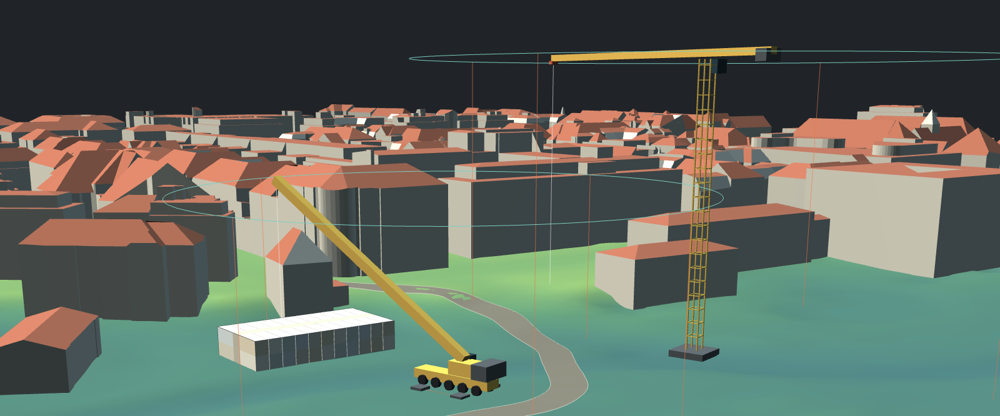

# Quick-Site-Design

*[English version](README.en.md)* · *[Benutzeranleitung](BENUTZERANLEITUNG.md)*

Werkzeug für die frühe Phase der Baustelleneinrichtung. Das amtliche
Geländemodell des Bauplatzes wird geladen und darauf gestellt, was wirklich
draufsteht: Container, Turmdrehkrane, Mobilkrane, Baustraßen. Alles maßstäblich,
alles auf echter Höhenlage.

Eine Kranaufstellung ist in zwei Minuten gesetzt und in weiteren zwei
umgestellt. Auf einen Blick sichtbar: ob die Ausladung reicht, ob sich zwei
Kranradien überschneiden, ob die Containeranlage auf die verfügbare Fläche passt
und wie die Baustraße im Gelände liegt. Eine Ausführungsplanung ersetzt das
nicht.

Technisch eine HTML-Datei von rund 150 KB und vier Bibliotheken daneben. Kein
Server, keine Installation, kein Build. Nach dem Öffnen bleiben alle Daten im
Browser.

**[→ Anwendung öffnen](https://quick-site-design.com/)**

---

## Funktionsumfang

**Geobasisdaten**
- GeoTIFF- und XYZ-Geländemodelle (bei XYZ mit Wahl des EPSG-Codes), mehrere Kacheln gleichzeitig. Die Pixel aller Kacheln
  werden in ein gemeinsames Raster gemittelt, unterschiedliche Auflösungen und
  Überlappungen sind daher unkritisch.
- CityGML LOD2, ebenfalls als Stapel. Die Achsenreihenfolge wird erkannt,
  Gebäude außerhalb der Kachel verworfen.
- Die Geländeauflösung passt sich automatisch dem Zoom an: nahe Teile in voller
  Datenauflösung (bis 1400 Stützpunkte je Achse), ferne gröber (Kacheln zu
  64 × 64 Zellen). Es gibt keinen Regler dafür. Höhenabfragen, Objekte und
  IFC-Export nutzen immer dieselben Daten.
- Koordinatenbezugssystem wird aus den GeoKeys gelesen.
- Bauwerk als IFC-Datei einlesen: Ist die Datei georeferenziert und hat dasselbe Bezugssystem wie das
  Gelände, wird sie automatisch platziert. Sonst legt man sie in einem Zwei-Punkt-Verfahren fest
  (zwei Punkte am Bauwerk, zwei im Gelände; das Bauwerk steht dabei immer waagerecht).

**Bausteine**
- Containeranlagen bis 25 nebeneinander, 2 Reihen, 5 Stockwerke. Bei zwei Reihen
  bleibt dazwischen ein Gang von einer Containerbreite, ausgefüllt von einem
  schlichten Verbindungsbau.
- Turmdrehkran als generisches Modell, Auslegerlänge, Hakenhöhe und Turmbreite
  frei einstellbar innerhalb der Bandbreite realer Baukrane.
- 24 Liebherr-Mobilkrane von 35 t bis 750 t, sämtliche Kennwerte aus den
  Original-Datenblättern, mit der echten Achszahl aus der Modellbezeichnung.
- Baugrube als Polygon (Rechtsklick oder Leertaste schließt): Tiefe zum mittleren Gelände
  (Standard −5 m) und Höhe der Unterkante sind zwei Regler für denselben Wert. Aushub
  und Aufschüttung stehen in m³ im Eigenschaftsfenster; im Gelände entsteht ein Loch,
  in das man hineinsieht. Der Böschungswinkel (20–90°, 90° = senkrecht) lässt die
  gezeichnete Kante oben stehen und verkleinert nur die Sohle.
- Optional: OpenStreetMap als Kartengrundlage auf dem Gelände (Schalter im Datenfenster, standardmäßig aus;
  beim Einschalten lädt der Browser Kacheln von tile.openstreetmap.org, die IP-Adresse wird dabei übertragen).
- Baustraßen als Polygonzug mit ausgerundeten Ecken und konstanter Längsneigung
  (Regler in %, vorbelegt aus Anfangs- und Endhöhe im Gelände). Länge und Fläche
  stehen im Eigenschaftsfenster. Wo die Fahrbahn über oder unter dem Gelände
  liegt, schließt eine Böschung an (1:1, 1:1,5 oder 1:2 wählbar); Auftrag und Abtrag erscheinen in m³
  (Mittelflächenverfahren). Bei Auswahl erscheinen die Stützpunkte und lassen
  sich versetzen, löschen oder ergänzen („Punkt hinzufügen“ fügt ihn in die nächste Strecke ein).
  Auf Wunsch prüft die Straße die Schleppkurve eines Sattelzugs (16,50 m, Fahrt auf der
  Straßenmitte): überstrichene Fläche im Plan, benötigte Breite und „passt / passt nicht“.

**Bedienung**
- Maus: linke Taste ziehen = umkreisen, rechte oder mittlere Taste ziehen =
  verschieben, Mausrad = zoomen. Wer links auf Gelände, Gebäude oder einen
  Baustein klickt und zieht, dreht um genau diesen Punkt; wer auf den Hintergrund
  klickt, kreist die ganze Szene um das Drehzentrum.
- Linksklick auf Gelände oder Gebäude setzt einen Messpunkt, zeigt Rechtswert,
  Hochwert und Höhe direkt am Punkt und macht ihn zum Dreh- und Zoomzentrum.
- **2D**-Knopf setzt die Ansicht senkrecht von oben; ein Ziehen kippt sie wieder
  frei in den Raum. Der Kompass zeigt die Nordrichtung und richtet auf Klick
  danach aus.
- Warnung bei sich überschneidenden Kranradien; der Radiusregler der Baustraße
  färbt sich, sobald der Mindestradius nicht mehr zwischen die Stützpunkte passt.
- Zwei Oberflächen (dunkel und hell), elf Schriftarten, Deutsch und Englisch.

---

## Demo

**[→ Demo öffnen](https://quick-site-design.com/?demo=1)**

Der Link lädt Gelände und Gebäude automatisch. Nach wenigen Sekunden steht ein
Quadratkilometer echtes Gelände mit 612 Gebäuden bereit — Baustein aus der
Leiste unten wählen und ins Gelände klicken.

Der Datensatz:

| Datei | Inhalt |
|---|---|
| `demo/demo_dgm.tif` | DGM1, 1000 × 1000 Punkte, 1 m Raster, Höhen 503,1 bis 520,7 m |
| `demo/demo_lod2.gml` | LoD2-Gebäudemodell, 612 Gebäude, auf die Kachel zugeschnitten |

ETRS89 / UTM Zone 32N (EPSG:25832), Südwestecke bei E 692000 / N 5336000,
gelegen bei etwa 48,153 Nord und 11,588 Ost.

Eigene Daten kommen über die beiden Dateifelder unter **Daten** hinein: zuerst
das Geländemodell, dann die Gebäude.

Die Beispieldaten stammen von der Bayerischen Vermessungsverwaltung
([geodaten.bayern.de](https://geodaten.bayern.de/opengeodata/OpenDataDetail.html?pn=dgm1)),
veröffentlicht unter [CC BY 4.0](https://creativecommons.org/licenses/by/4.0/deed.de).
Die Namensnennung wird in der Anwendung angezeigt, solange die Beispieldaten
geladen sind.

---

## Wichtiger Hinweis zu den Krandaten

Die hinterlegten Kranwerte sind **Richtwerte**. Sie stammen aus den
veröffentlichten Datenblättern der Hersteller, sind aber von Rüstzustand,
Turmkombination und Ballastierung abhängig.

**Für die Einsatzplanung ist ausschließlich die Traglasttabelle des jeweiligen
Krans maßgeblich.** Die Anwendung ersetzt keine statische Prüfung, keine
Standsicherheitsberechnung und keine Abstimmung mit dem Kranvermieter.

Abstützmaße und Fahrzeuglängen dienen allein der Darstellung und sind
schematisch.

---

## Datenquellen

Nicht jedes Bundesland bietet das DGM1 als GeoTIFF an, und nicht jedes Portal
stellt es erkennbar als Open Data bereit. Die Portale unterscheiden sich in
Format, Kachelung, Zugang und Lizenz. Die Tabelle nennt DGM1 und
3D-Gebäudemodell (LoD2) je Land; die Links sind im November 2026 geprüft.
Ein ⚠ in der Formatspalte heißt: kein GeoTIFF (XYZ lässt sich direkt laden).

| Land | Stelle | DGM1-Portal | DGM1-Format | Gebäudemodell (LoD2) | Lizenz (DGM1) |
|---|---|---|---|---|---|
| Baden-Württemberg | LGL-BW | [opengeodata.lgl-bw.de](https://opengeodata.lgl-bw.de/) | ⚠ XYZ-Text (GeoTIFF nur beim DGM025, 0,25 m) | [opengeodata.lgl-bw.de](https://opengeodata.lgl-bw.de/) (CityGML, 2 × 2 km) | dl-de/by-2-0 |
| Bayern | Bayer. Vermessungsverwaltung | [geodaten.bayern.de](https://geodaten.bayern.de/opengeodata/OpenDataDetail.html?pn=dgm1) | GeoTIFF | [geodaten.bayern.de](https://geodaten.bayern.de/opengeodata/OpenDataDetail.html?pn=lod2) | cc-by/4.0 |
| Berlin | — | in den Brandenburg-Daten enthalten (nicht geprüft) | — | [gdi.berlin.de](https://gdi.berlin.de/geonetwork/srv/api/records/3c7c49af-00a4-3bcd-bc00-20e7f0f1b7bf) | — |
| Brandenburg | LGB | [data.geobasis-bb.de](https://data.geobasis-bb.de/geobasis/daten/) | GeoTIFF (auch XYZ) | [data.geobasis-bb.de](https://data.geobasis-bb.de/geobasis/daten/3d_gebaeude/) | dl-de/by-2-0 |
| Bremen | LGV Bremen | [GDI-DE-Katalog](https://gdk.gdi-de.org/geonetwork/srv/api/records/C448202A-0F15-413A-99E6-F22F10E190C9) | ⚠ XYZ-ASCII | [geo.bremen.de](https://www.geo.bremen.de/produkte/3d-produkte/3d-gebaeudemodelle-11892) | cc-by/4.0 |
| Hamburg | LGV Hamburg | [metaver.de](https://metaver.de/trefferanzeige?docuuid=A39B4E86-15E2-4BF7-BA82-66F9913D5640) | ⚠ XYZ-ASCII, 2 × 2 km (das Paket 2022 ist als „PNG“ ausgewiesen, nicht geprüft) | [metaver.de](https://metaver.de/trefferanzeige?docuuid=1F6E48EB-3B7B-4F61-AE3C-C03079ECCAEA) (GML) | dl-de/by-2-0 |
| Hessen | HVBG | [hvbg.hessen.de](https://hvbg.hessen.de/landesvermessung/geotopographie/3d-daten/digitale-gelaendemodelle) | GeoTIFF | [hvbg.hessen.de](https://hvbg.hessen.de/landesvermessung/geotopographie/3d-daten/3d-gebaeudemodelle) | dl-de/by-2-0 |
| Mecklenburg-Vorpommern | LAiV MV | [laiv.geodaten-mv.de](https://laiv.geodaten-mv.de/afgvk/Geotopographie/Download?produkt=DGM1) | GeoTIFF | [laiv.geodaten-mv.de](https://laiv.geodaten-mv.de/afgvk/Geotopographie/Beschreibung?produkt=3DGbm) | dl-de/by-2-0 |
| Niedersachsen | LGLN | [ni-lgln-opengeodata.hub.arcgis.com](https://ni-lgln-opengeodata.hub.arcgis.com/pages/digitales-gel-ndemodell-dgm1) | GeoTIFF (COG) | [ni-lgln-opengeodata.hub.arcgis.com](https://ni-lgln-opengeodata.hub.arcgis.com/pages/3d-geb-udemodell-lod2) | cc-by/4.0 |
| Nordrhein-Westfalen | Geobasis NRW | [opengeodata.nrw.de](https://www.opengeodata.nrw.de/produkte/geobasis/hm/dgm1_tiff/) | GeoTIFF | [opengeodata.nrw.de](https://www.opengeodata.nrw.de/produkte/geobasis/3dg/lod2_gml/) | dl-de/by-2-0 |
| Rheinland-Pfalz | LVermGeo RP | [geoshop.rlp.de](https://geoshop.rlp.de/opendata-dgm1.html) | ⚠ XYZ-ASCII (laut Metadaten, GeoTIFF nur als Alternative) | [geoshop.rlp.de](https://geoshop.rlp.de/opendata-geb3dlo.html) | dl-de/by-2-0 |
| Saarland | LVGL-SL | [saarland.de/lvgl](https://www.saarland.de/lvgl/DE/themen-aufgaben/themen/geotopographie/digitalegelaendemodelle/digitalegelaendemodelle) | ⚠ unklar: die Seite beschreibt das DGM1, bietet aber keinen Download | — (nur INSPIRE-Dienste, nicht als Open Data bestätigt) | ⚠ widersprüchlich: Metadaten nennen dl-de/by-2-0, andere Angaben kostenpflichtigen Download |
| Sachsen | GeoSN | [geodaten.sachsen.de](https://www.geodaten.sachsen.de/downloadbereich-digitale-hoehenmodelle-4851.html) | GeoTIFF | [geodaten.sachsen.de](https://www.geodaten.sachsen.de/downloadbereich-digitale-3d-stadtmodelle-4875.html) | dl-de/by-2-0 |
| Sachsen-Anhalt | LVermGeo ST | [lvermgeo.sachsen-anhalt.de](https://www.lvermgeo.sachsen-anhalt.de/de/gdp-dgm-dom-lsa.html) | GeoTIFF (XYZ optional) | [lvermgeo.sachsen-anhalt.de](https://www.lvermgeo.sachsen-anhalt.de/de/gdp-3d-gebaeudemodell.html) | dl-de/by-2-0 |
| Schleswig-Holstein | LVermGeo SH | [opendata.schleswig-holstein.de](https://opendata.schleswig-holstein.de/dataset/digitales-gelandemodell-1-dgm1) | ⚠ XYZ-ASCII | [OpenGBD-Portal](https://www.schleswig-holstein.de/DE/landesregierung/ministerien-behoerden/LVERMGEOSH/Themen/themaOpenGbd) (LoD2 nicht geprüft) | cc-by/4.0 |
| Thüringen | TLBG | [tlbg.thueringen.de](https://tlbg.thueringen.de/geobasisdaten/3d-informationen/digitale-gelaendemodelle) | GeoTIFF (teils Punktwolken) | [tlbg.thueringen.de](https://tlbg.thueringen.de/geobasisdaten/3d-informationen/3d-gebaeudemodelle) | dl-de/by-2-0 |

**Format.** Quick-Site-Design erwartet GeoTIFF mit Höhenwerten als Gleitkomma
und einer Georeferenz im Header. GeoTIFF bieten Bayern, Brandenburg, Hessen,
Mecklenburg-Vorpommern, Niedersachsen (als Cloud-Optimized GeoTIFF),
Nordrhein-Westfalen, Sachsen, Sachsen-Anhalt und Thüringen an. Baden-Württemberg
(DGM1 seit März 2026), Bremen, Hamburg, Rheinland-Pfalz und Schleswig-Holstein
geben XYZ-Text aus, im Saarland ist das Angebot unklar. XYZ-Dateien (`.xyz`,
`.txt`, `.csv`; Rechtswert, Hochwert, Höhe auf einem regelmäßigen Raster) liest die
Anwendung direkt. Da sie kein Bezugssystem enthalten, wählt man es im Datenfenster
oder tippt den EPSG-Code ein. ESRI-ASCII-Raster (`.asc`) werden nicht gelesen, die
muss man mit GDAL in GeoTIFF umwandeln.

**Dateigröße.** Das Tool liest jede Datei ganz in den Speicher. Es lehnt deshalb
Dateien über 1 GB, Kacheln über 100 Mio. Pixel und mehr als 150 Mio. Pixel (2 GB)
insgesamt vor dem Einlesen mit einer Meldung ab. Das betrifft vor allem Österreich:
Die BEV-Raster mit 1 m und die 10-m-Datei für ganz Österreich sind viel größer. Dort
vorher einen Ausschnitt schneiden, etwa mit `gdal_translate -projwin`.

**Saarland.** Die Seite des LVGL beschreibt das DGM1, enthält aber keinen
Download, und die Angaben zur Lizenz widersprechen sich. Bis das geklärt ist,
gilt „kostenfrei als Open Data“ für das Saarland nicht als belegt.

**Kachelung.** Meist 1 × 1 km, teilweise 2 × 2 km. Mehrere Kacheln lassen sich
gemeinsam auswählen und werden beim Laden verschmolzen.

**Gebäudemodelle.** Die Links der Spalte „Gebäudemodell (LoD2)“ führen auf die
jeweilige Produktseite; die Daten liegen als CityGML vor, teils unter
abweichenden Lizenzen. Für Schleswig-Holstein ist das LoD2-Angebot nicht
bestätigt, für das Saarland gibt es nur Dienste.

**Lizenzpflicht.** Die genannten Lizenzen verlangen eine Quellenangabe. Der
genaue Wortlaut steht in den Metadaten des jeweiligen Landes.

### Österreich

Die Daten kommen vom Bund und von einzelnen Ländern und Städten; ein
landesweites 3D-Gebäudemodell gibt es nicht. Verzeichnet sind nur Angebote, die
im November 2026 geprüft wurden. Steiermark, Niederösterreich, Kärnten und
Vorarlberg sind nicht geprüft.

| Stelle | Geländemodell | Format | Gebäudemodell (LoD2) | Lizenz |
|---|---|---|---|---|
| Bund (BEV) | [ALS-Höhenraster 1 m](https://www.bev.gv.at/Services/Produkte/Digitales-Gelaendehoehenmodell/ALS-Hoehenraster.html), Download auf data.bev.gv.at | GeoTIFF (COG), ⚠ EPSG:3035 | — | CC BY 4.0 |
| Bund (10 m) | [DGM Österreich 10 m](https://www.data.gv.at/katalog/dataset/d88a1246-9684-480b-a480-ff63286b35b7) | GeoTIFF | — | CC BY 4.0 |
| Wien | [Geländemodell Raster 1 m](https://www.data.gv.at/katalog/dataset/1eda4b16-05e3-43c3-b5b0-ef8276df0701) | GeoTIFF und ASCII | [Dachmodell LoD2.1](https://www.data.gv.at/katalog/dataset/86d88cae-ad97-4476-bae5-73488a12776d) | CC BY 4.0 |
| Tirol | [DGM Tirol](https://www.data.gv.at/katalog/dataset/0454f5f3-1d8c-464e-847d-541901eb021a) | GeoTIFF (0,5 m, 5 m, 10 m), XYZ-Grid (1 m) | — | CC BY 4.0 |
| Salzburg | [DGM 1 m](https://www.data.gv.at/katalog/dataset/093d4dec-8397-4faf-b690-b8cbe9a9dc31) | TIF mit World-File und ASCII, gemeindeweise | — | nicht geprüft |
| Oberösterreich | [DGM 0,5 m](https://www.data.gv.at/katalog/dataset/68cfe491-7cdf-4781-a1f1-603cd0738abd) | GeoTIFF und XYZ, EPSG:31255 | — | CC BY 4.0 |
| Burgenland | [Höhenmodelle und Orthofotos](https://geodaten.bgld.gv.at/de/downloads/hoehenmodelle-orthofotos.html) | nicht geprüft | — | nicht geprüft |
| Linz (Stadt) | — | — | [3D-Geodaten LoD2 2018](https://www.data.gv.at/katalog/dataset/5f4440ca-90b7-4875-a0e4-bce7f8abb13e), Gauß-Krüger M31 | CC BY 4.0 |

Das BEV liefert seine Höhenraster in EPSG:3035 (ETRS89-LAEA). Die Kartengrundlage
(OpenStreetMap) rechnet dieses System nicht um und schaltet sich dort mit einer
Meldung ab; die Gauß-Krüger-Systeme MGI (EPSG:31254 bis 31256) funktionieren.

---

## Aufbau des Repositorys

```
quick-site-design/
├── index.html            die Anwendung, aus src/ gebaut
├── impressum.html
├── datenschutz.html
├── README.md
├── README.en.md
├── BENUTZERANLEITUNG.md  Benutzeranleitung (Deutsch), der Hilfe-Knopf verweist darauf
├── USER-GUIDE.en.md      Benutzeranleitung (Englisch)
├── PROJEKT.md            Entwicklernotizen
├── LICENSE
├── build.py
├── .gitignore
├── lib/
│   ├── three.min.js      Bibliotheken, lokal statt vom CDN
│   ├── OrbitControls.js
│   ├── geotiff.js
│   ├── web-ifc-api-iife.js   IFC-Leser (wird erst beim IFC-Import geladen)
│   ├── web-ifc.wasm
│   ├── LICENSE-web-ifc.txt
│   └── LIESMICH.txt      welche Datei woher kommt
├── demo/
│   ├── demo_dgm.tif      Geländemodell für den Demo-Link
│   ├── demo_lod2.gml     Gebäudemodell für den Demo-Link
│   └── LIESMICH.txt      Quelle und Lizenz der Beispieldaten
├── docs/
│   └── header.png        Titelbild für das README
├── src/
│   ├── shell_head.html
│   ├── app.js
│   ├── ui.js
│   └── boot.js
└── test/
    ├── test.js
    ├── test-ui.js
    ├── validate-html.js
    ├── demo-check.js
    ├── three-stub.js
    └── xml-stub.js
```

`index.html` wird mit `python3 build.py` aus den vier Dateien in `src/`
zusammengesetzt. Die Tests in `test/` laufen mit `node` und brauchen keinen
Browser. Einzelheiten stehen in `PROJEKT.md`.

---

## Selbst betreiben

Die Anwendung braucht vier Bibliotheken:

| Bibliothek | Lizenz |
|---|---|
| three.js r128 | MIT |
| OrbitControls (three.js examples) | MIT |
| geotiff.js 2.1.3 | MIT |
| web-ifc 0.0.79 (nur für den IFC-Import) | MPL-2.0 |

Alle vier sind mit der GPLv3 verträglich und liegen im Ordner `lib/`. Sie
werden **nicht** von einem CDN nachgeladen: so entstehen beim Aufruf keine
Verbindungen zu fremden Servern, und die Anwendung läuft auch ohne
Internetverbindung.

Die Bibliotheksdateien selbst sind nicht im Repository enthalten; ihre
Bezugsquellen stehen in [`lib/LIESMICH.txt`](lib/LIESMICH.txt).

Für den Betrieb auf eigenem Webspace genügt `index.html` mitsamt den Ordnern
`lib/` und `demo/` im Web-Verzeichnis. Der Ordner `demo/` wird nur für den
Demo-Link gebraucht.

---

## Rechtliches

[Impressum](impressum.html) · [Datenschutzerklärung](datenschutz.html)

---

## Lizenz

Copyright © 2026 Haoran Li

GNU General Public License, Version 3 oder später. Siehe [LICENSE](LICENSE).

In Kurzform: Die Software darf genutzt, weitergegeben und verändert werden.
Wird eine veränderte Fassung weitergegeben, muss auch diese unter der GPLv3
stehen und der Quelltext offenliegen.

Die Software wird ohne jede Gewährleistung bereitgestellt.
